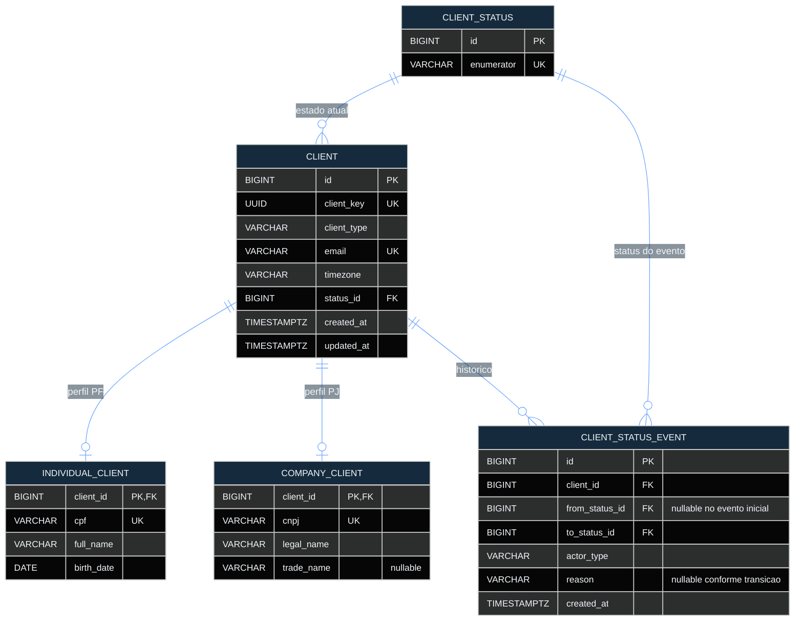
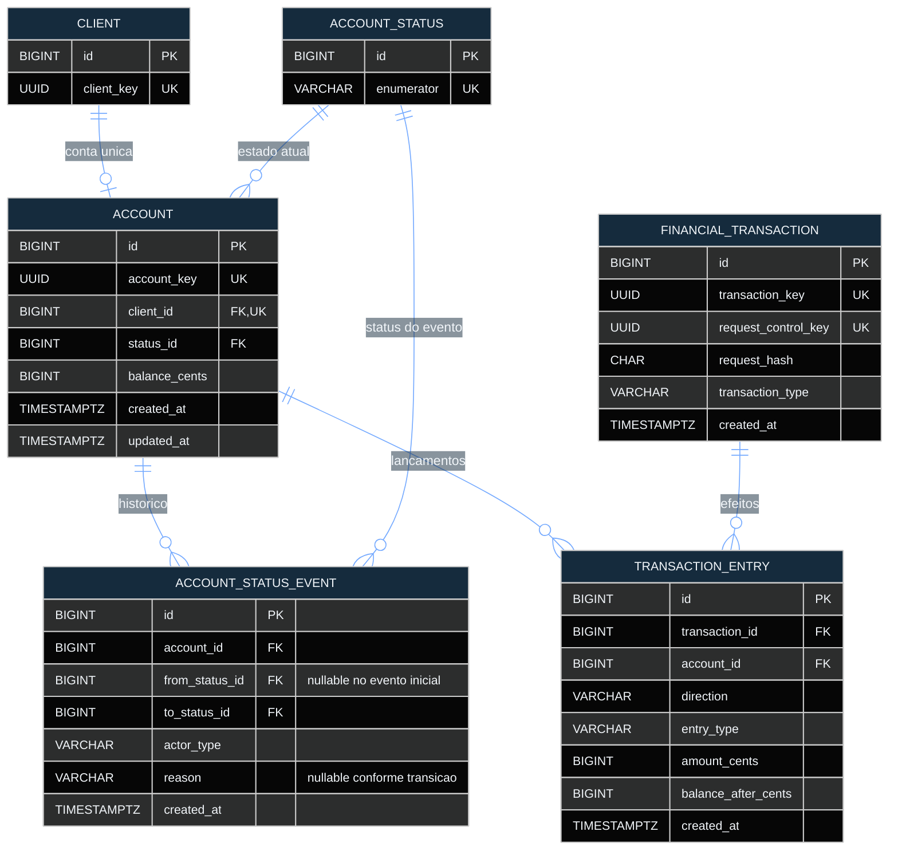

# Modelo de Dados (ERD) — BaaS Simplificado

**Bootcamp QI Tech 2026**

**Autores:** João Vitor Miranda Sousa · Mohamad Ahmad Barakat

**Versão:** Final · 12/10/2026

**Documentos relacionados:** [RFC](RFC.md) · [RFC em PDF](RFC.pdf) · [Rotas](ROTAS.md) · [Fluxos](FLUXOS.md) · [Esquema PostgreSQL](../database/database.sql)

**Diagrama interativo:** [Visualizar o modelo no dbdiagram.io](https://dbdiagram.io/d/ERD-bootcamp-QItech-6abc58be5869425612d24fa6)

## 1. Visão geral

O **BaaS Simplificado** utiliza PostgreSQL para persistir os dados cadastrais de pessoas físicas (PF) e jurídicas (PJ), o ciclo de vida de clientes e contas e as movimentações financeiras. O modelo atende ao escopo brasileiro do produto, com valores monetários em **BRL**, representados por inteiros em centavos.

A estrutura contém **10 tabelas**, organizadas em três domínios:

| Domínio | Entidades | Responsabilidade |
|---|---|---|
| Cadastro | `client`, `individual_client`, `company_client`, `client_status`, `client_status_event` | Identidade PF/PJ, estado cadastral e histórico de transições |
| Contas | `account`, `account_status`, `account_status_event` | Conta vinculada ao cliente, saldo e histórico de estados |
| Financeiro | `financial_transaction`, `transaction_entry` | Operações, idempotência e lançamentos que compõem o extrato |

Para manter os relacionamentos legíveis, a representação Mermaid é dividida em **dois diagramas complementares**. A tabela `client` é repetida de forma resumida no segundo desenho apenas para estabelecer a ligação entre cadastro e contas; existe uma única tabela `client` no banco.

## 2. Diagramas de entidade-relacionamento

### 2.1 Cadastro, perfis PF/PJ e estados do cliente



### 2.2 Contas, estados e movimentações financeiras



**Legenda:** `PK` = chave primária; `FK` = chave estrangeira; `UK` = restrição de unicidade. A notação `||--o|` representa no máximo um registro dependente por entidade principal; `||--o{` representa zero ou muitos. Nos históricos, `from_status_id` e `to_status_id` referenciam a respectiva tabela de estados; a associação foi reunida visualmente para simplificar a leitura, sem eliminar as chaves do esquema físico.

## 3. Relacionamentos e cardinalidades

| Relacionamento | Cardinalidade e regra de integridade |
|---|---|
| `client_status → client` | Cada cliente possui um estado atual; um estado pode estar associado a vários clientes. |
| `client → individual_client` | No máximo um perfil PF por cliente, via `client_id` como PK e FK. |
| `client → company_client` | No máximo um perfil PJ por cliente, via `client_id` como PK e FK. |
| `client → client_status_event` | Um cliente pode possuir vários eventos de transição cadastral. |
| `client_status → client_status_event` | `to_status_id` obrigatório; `from_status_id` opcional para o evento inicial. |
| `client → account` | Zero ou uma conta por cliente, garantido por `UNIQUE(account.client_id)`. |
| `account_status → account` | Cada conta possui um estado atual; um estado pode estar associado a várias contas. |
| `account → account_status_event` | Uma conta pode possuir vários eventos de alteração de estado. |
| `account_status → account_status_event` | `to_status_id` obrigatório; `from_status_id` opcional para o evento inicial. |
| `account → transaction_entry` | Uma conta pode possuir vários lançamentos de débito ou crédito. |
| `financial_transaction → transaction_entry` | Cada lançamento pertence a uma operação; uma operação confirmada registra seus efeitos na mesma transação do banco. |

A separação entre `individual_client` e `company_client` atende à especialização PF/PJ definida por `client.client_type`. A aplicação mantém **um perfil compatível com o tipo de cliente** durante a criação cadastral.

## 4. Integridade e regras de negócio

### 4.1 Clientes e contas

- **Identificadores:** chaves internas `BIGINT` e identificadores públicos `UUID` (`client_key`, `account_key` e `transaction_key`).
- **Cadastro:** CPF, CNPJ e email possuem restrições de unicidade; dados obrigatórios são definidos por `NOT NULL` e pela validação de domínio. O email é normalizado antes da persistência.
- **Perfis:** clientes `INDIVIDUAL` possuem os dados de CPF, nome e nascimento; clientes `COMPANY` possuem CNPJ e razão social, com nome fantasia opcional. Para PF, aplica-se a idade mínima de 18 anos.
- **Fuso horário:** `client.timezone` armazena um identificador IANA de referência do cliente, utilizado para interpretar filtros por datas civis.
- **Estados do cliente:** `PENDING`, `ACTIVE`, `REJECTED` e `INACTIVE`; alterações registram estado anterior, novo estado, ator, motivo quando aplicável e data/hora.
- **Conta:** um cliente ativo pode abrir uma conta; a conta é criada `ACTIVE`, com saldo inicial de zero. Seus estados possíveis são `ACTIVE`, `INACTIVE` e `CLOSED`.
- **Saldo:** `account.balance_cents` é um `BIGINT` com `DEFAULT 0` e `CHECK (balance_cents >= 0)`. A conta encerrada não é reaberta e a abertura de outra conta para o mesmo cliente é impedida pela unicidade de `client_id`.

### 4.2 Operações financeiras e extrato

- `financial_transaction` identifica a operação financeira (`DEPOSIT` ou `TRANSFER`) e armazena a chave de idempotência recebida no header HTTP `Idempotency-Key` como `request_control_key`, única no banco, com `request_hash` para distinguir a intenção da requisição.
- `transaction_entry` registra cada lançamento por conta, sua direção (`DEBIT` ou `CREDIT`), natureza (`PRINCIPAL` ou `FEE`), valor e saldo resultante.
- Os valores são representados em **centavos**, sem uso de ponto flutuante: `amount_cents > 0` e `balance_after_cents >= 0` são garantidos por restrições `CHECK`.
- **Depósito:** registra um crédito principal na conta destinatária.
- **Transferência interna:** registra débito principal na origem, débito da tarifa na origem e crédito principal no destino. A tarifa de transferência é calculada pela aplicação de acordo com o tipo do cliente de origem: PF — 0,50% (mínimo 50 e máximo 1.000 centavos); PJ — 1,00% (mínimo 100 e máximo 1.500 centavos), com arredondamento `HALF_UP`.
- **Atomicidade:** registros financeiros e atualizações de saldo pertencem à mesma transação PostgreSQL. Em caso de falha, ocorre `ROLLBACK`, evitando efeitos parciais.
- **Concorrência:** o processamento de movimentações utiliza bloqueios de linha e ordenação consistente de aquisição dos bloqueios nas contas envolvidas.
- **Extrato (R08):** consulta os lançamentos associados à conta e às respectivas operações, com paginação e filtros por data; a interpretação das datas considera o fuso horário cadastrado do cliente. Principal e tarifa são apresentados como lançamentos distintos.

### 4.3 Restrições e índices do PostgreSQL

O esquema combina `PRIMARY KEY`, `FOREIGN KEY`, `UNIQUE`, `NOT NULL`, `CHECK` e `ON DELETE RESTRICT` para preservar as relações e impedir estados incompatíveis com as restrições físicas. As regras de transição, especialização exclusiva PF/PJ, ordem dos lançamentos e processamento idempotente são coordenadas pela camada de aplicação dentro das transações de banco.

Além dos índices de suporte criados pelas chaves primárias e pelas restrições de unicidade, a estrutura inclui:

| Índice | Tabela e colunas | Finalidade |
|---|---|---|
| `idx_client_status` | `client(status_id)` | Consulta por estado cadastral |
| `idx_client_status_event_history` | `client_status_event(client_id, created_at, id)` | Consulta ordenada do histórico do cliente |
| `idx_account_status` | `account(status_id)` | Consulta por estado da conta |
| `idx_account_status_event_history` | `account_status_event(account_id, created_at, id)` | Consulta ordenada do histórico da conta |

## 5. Decisões de modelagem e alternativas

As decisões abaixo priorizam **integridade transacional, clareza do domínio e simplicidade operacional** para o escopo do bootcamp. Cada alternativa representa um desenho tecnicamente possível e evidencia a razão da escolha adotada.

| Decisão adotada | Alternativa | Vantagens da escolha | Trade-off |
|---|---|---|---|
| Entidade `client` com tabelas especializadas PF/PJ | Uma única tabela com campos de ambos os perfis | Evita colunas de perfis incompatíveis e mantém dados comuns centralizados | A exclusividade do perfil exige regra de aplicação |
| Estado atual + tabela de eventos | Apenas o estado atual ou event sourcing integral | Leituras diretas do estado e rastreabilidade das transições | Estado e evento precisam ser gravados atomicamente |
| Uma conta por cliente, com `UNIQUE(client_id)` | Múltiplas contas por cliente | Regra assegurada também sob concorrência | Ampliação futura exige revisão do relacionamento |
| Saldo atual em `account` + lançamentos históricos | Recalcular o saldo a cada consulta | Consultas de saldo eficientes com histórico detalhado | Exige atualização conjunta de saldo e lançamentos |
| Operação financeira + lançamentos por conta | Uma linha isolada por transferência ou ledger contábil completo | Representa efeitos de depósito, transferência e tarifa de forma clara | Não pretende substituir um ledger bancário de partidas dobradas |
| `BIGINT` em centavos | `FLOAT` para valores monetários | Elimina imprecisões típicas de ponto flutuante | A unidade monetária é controlada pela aplicação |
| Chave idempotente persistida e única + hash da requisição | Deduplicação apenas em memória | Segurança diante de retentativas e reinicialização do serviço | Exige armazenamento durável da intenção |
| Bloqueios de linha e transações PostgreSQL | Apenas leitura e verificação prévia de saldo | Coordena movimentações concorrentes e evita atualizações perdidas | Necessita controle da ordem e duração dos bloqueios |
| Fuso IANA explícito no cadastro | Inferir fuso por localização | Interpretação previsível das datas financeiras | Requer validação do valor informado |

## 6. Especificação DBML complementar

A representação abaixo permite reproduzir o modelo em ferramentas de visualização como o `dbdiagram.io`, com os tipos, identificadores, unicidades, índices e referências adotados na estrutura do banco. O **DDL PostgreSQL em [`database/database.sql`](../database/database.sql)** permanece como especificação executável do esquema.

```dbml
Table client_status {
  id bigint [pk, increment, not null]
  enumerator varchar(20) [not null, unique, note: 'PENDING, ACTIVE, REJECTED ou INACTIVE']
}

Table client {
  id bigint [pk, increment, not null]
  client_key uuid [not null, unique, note: 'Identificador publico']
  client_type varchar(20) [not null, note: 'INDIVIDUAL ou COMPANY']
  email varchar(254) [not null, unique, note: 'Trim + lowercase']
  timezone varchar(64) [not null, note: 'Timezone IANA de referencia do produto, informado pelo Partner Backend; D0 Brasil']
  status_id bigint [not null]
  created_at timestamptz [not null]
  updated_at timestamptz [not null]

  indexes {
    status_id [name: 'idx_client_status']
  }
}

Table individual_client {
  client_id bigint [pk, not null]
  cpf varchar(11) [not null, unique, note: 'Somente digitos']
  full_name varchar(200) [not null]
  birth_date date [not null, note: 'Idade minima de 18 anos por regra do produto D0']
}

Table company_client {
  client_id bigint [pk, not null]
  cnpj varchar(14) [not null, unique, note: 'Somente digitos']
  legal_name varchar(200) [not null]
  trade_name varchar(200) [note: 'Opcional']
}

Table client_status_event {
  id bigint [pk, increment, not null]
  client_id bigint [not null]
  from_status_id bigint [note: 'NULL somente no evento inicial']
  to_status_id bigint [not null]
  actor_type varchar(20) [not null, note: 'SYSTEM ou INTERNAL']
  reason varchar(500) [note: 'Obrigatorio conforme a transicao']
  created_at timestamptz [not null]

  indexes {
    (client_id, created_at, id) [name: 'idx_client_status_event_history']
  }
}

Table account_status {
  id bigint [pk, increment, not null]
  enumerator varchar(20) [not null, unique, note: 'ACTIVE, INACTIVE ou CLOSED']
}

Table account {
  id bigint [pk, increment, not null]
  account_key uuid [not null, unique, note: 'Identificador publico']
  client_id bigint [not null, unique, note: 'No maximo uma conta por cliente durante toda a vida']
  status_id bigint [not null]
  balance_cents bigint [not null, default: 0, note: 'CHECK balance_cents >= 0']
  created_at timestamptz [not null]
  updated_at timestamptz [not null]

  indexes {
    status_id [name: 'idx_account_status']
  }
}

Table account_status_event {
  id bigint [pk, increment, not null]
  account_id bigint [not null]
  from_status_id bigint [note: 'NULL somente no evento inicial']
  to_status_id bigint [not null]
  actor_type varchar(20) [not null, note: 'SYSTEM ou INTERNAL']
  reason varchar(500) [note: 'Obrigatorio conforme a transicao']
  created_at timestamptz [not null]

  indexes {
    (account_id, created_at, id) [name: 'idx_account_status_event_history']
  }
}

Table financial_transaction {
  id bigint [pk, increment, not null]
  transaction_key uuid [not null, unique, note: 'Identificador publico da operacao']
  request_control_key uuid [not null, unique, note: 'UNIQUE global; identidade idempotente da intencao']
  request_hash char(64) [not null, note: 'SHA-256 da intencao normalizada']
  transaction_type varchar(20) [not null, note: 'DEPOSIT ou TRANSFER']
  created_at timestamptz [not null]
}

Table transaction_entry {
  id bigint [pk, increment, not null]
  transaction_id bigint [not null]
  account_id bigint [not null]
  direction varchar(10) [not null, note: 'DEBIT ou CREDIT']
  entry_type varchar(20) [not null, note: 'PRINCIPAL ou FEE']
  amount_cents bigint [not null, note: 'CHECK amount_cents > 0']
  balance_after_cents bigint [not null, note: 'CHECK balance_after_cents >= 0; saldo imediatamente apos esta entry']
  created_at timestamptz [not null, note: 'Timestamp tecnico da row']
}

Ref: client.status_id > client_status.id [delete: restrict]

Ref: individual_client.client_id > client.id [delete: restrict]
Ref: company_client.client_id > client.id [delete: restrict]

Ref: client_status_event.client_id > client.id [delete: restrict]
Ref: client_status_event.from_status_id > client_status.id [delete: restrict]
Ref: client_status_event.to_status_id > client_status.id [delete: restrict]

Ref: account.client_id > client.id [delete: restrict]
Ref: account.status_id > account_status.id [delete: restrict]

Ref: account_status_event.account_id > account.id [delete: restrict]
Ref: account_status_event.from_status_id > account_status.id [delete: restrict]
Ref: account_status_event.to_status_id > account_status.id [delete: restrict]

Ref: transaction_entry.transaction_id > financial_transaction.id [delete: restrict]
Ref: transaction_entry.account_id > account.id [delete: restrict]
```
