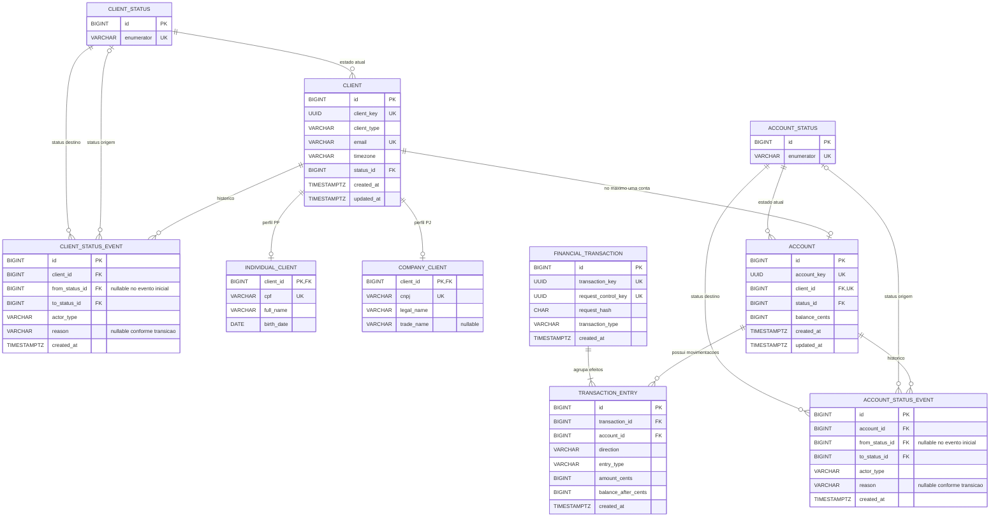

# ERD v1.1 — BaaS Simplificado
## Bootcamp QI Tech 2026

**Time:** João Vitor + Moha  
**Data:** 06/10/2026  
**Versão:** 1.1  
**Status:** ERD v1.1 — CONGELADO / APROVADO para servir de fonte de Rotas v1.1, Fluxos v1.1, RFC final e implementação.

> Este documento consolida as decisões mais recentes do projeto.  
> Quando houver conflito com documentos antigos, prevalecem as decisões explícitas mais recentes do time.
>
> **Contexto de negócio:** BaaS simplificado para uma plataforma digital que atende usuários PF e PJ e precisa incorporar contas e movimentações financeiras sem desenvolver internamente todo o core bancário.
>
> **D0:** uma plataforma parceira por implantação, produto restrito ao Brasil e moeda única `BRL`. `PARTNER`/multi-tenancy não entra no ERD do MVP; a v1.1 não simula internacionalização apenas com `country_code` e não persiste `currency_code` porque a moeda é fixa no produto.

---

# 1. ERD — Mermaid

> No VS Code, abra este `.md` e use `Ctrl + Shift + V` para visualizar o diagrama no preview Markdown, desde que o ambiente esteja com suporte a Mermaid.



---

# 2. Leitura do modelo

## 2.1 Cliente

O núcleo cadastral possui uma entidade comum:

```text
CLIENT
```

com especialização exclusiva em exatamente uma das tabelas:

```text
INDIVIDUAL_CLIENT
COMPANY_CLIENT
```

Regras atuais:

```text
client_type = INDIVIDUAL | COMPANY
email = obrigatório, trim + lowercase, UNIQUE global
timezone = obrigatório, identificador IANA informado pelo Partner Backend no onboarding
PF = cpf + full_name + birth_date
PJ = cnpj + legal_name + trade_name opcional
idade mínima PF = 18 anos por decisão explícita do produto D0
sem idade máxima artificial
```

A regra de exatamente uma especialização PF/PJ é garantida por fluxo de criação, mesma transação PostgreSQL, regra de negócio e testes. Não será criada trigger XOR no MVP.

Telefone e endereço permanecem fora do D0 porque nenhum caso de uso atual depende desses dados. Também não armazenamos `UF` ou `country_code` apenas para inferir localização: o D0 é brasileiro e o `timezone` é informado explicitamente pelo Partner Backend, sem inferência por IP, CEP, endereço ou UF.

### Timezone do CLIENT

`CLIENT.timezone` representa o **timezone de referência do relacionamento financeiro no produto**, usado principalmente para interpretar datas civis de filtros como `date_from` e `date_to`. Ele não representa necessariamente endereço físico, residência ou sede cadastral do cliente.

No D0:

```text
timezone
-> obrigatório no onboarding
-> identificador IANA
-> deve pertencer ao conjunto de timezones brasileiros suportados pelo produto
-> não é inferido por UF/IP/CEP/endereço
-> não é alterável pelas rotas atuais
```

A validação será centralizada na aplicação:

```text
timezone IANA válido
+
timezone pertencente ao conjunto suportado pelo D0 Brasil
```

Não será criado `CHECK` estático de timezone no PostgreSQL e não será criada tabela `UF -> timezone`.

---

## 2.2 Lifecycle do cliente

Estados:

```text
PENDING
ACTIVE
REJECTED
INACTIVE
```

Estado atual:

```text
CLIENT.status_id
```

Histórico append-only:

```text
CLIENT_STATUS_EVENT
```

`from_status_id` é `NULL` apenas no evento inicial:

```text
NULL -> PENDING
```

`actor_type` registra a origem da transição:

```text
SYSTEM
INTERNAL
```

Não existe `operator_id` no MVP, pois não há autenticação individual de operadores internos.

`reason` é obrigatório nas transições definidas pelo domínio que exigem justificativa, incluindo rejeição, reanálise, inativação e reativação.

Na v1.1, `REJECTED -> PENDING` continua permitido para reanálise, mas **não existe limite máximo de quantidade de reanálises**. Cada ciclo permanece registrado no histórico append-only; foi removida a regra arbitrária de três reanálises.

---

## 2.3 Conta

Cardinalidade:

```text
1 CLIENT -> 0 ou 1 ACCOUNT durante toda a vida do cliente
```

Garantia estrutural:

```text
ACCOUNT.client_id UNIQUE
```

A conta só é aberta para `CLIENT = ACTIVE` e nasce `ACTIVE`.

Estados:

```text
ACTIVE
INACTIVE
CLOSED
```

`CLOSED` é terminal.

A conta só pode ser encerrada quando:

```text
balance_cents == 0
```

Estado atual:

```text
ACCOUNT.status_id
```

Histórico append-only:

```text
ACCOUNT_STATUS_EVENT
```

Também possui:

```text
actor_type = SYSTEM | INTERNAL
```

---

# 3. Modelo financeiro

O modelo escolhido é:

```text
FINANCIAL_TRANSACTION
+
TRANSACTION_ENTRY
+
ACCOUNT.balance_cents
```

Interpretação:

```text
FINANCIAL_TRANSACTION
= operação financeira completa

TRANSACTION_ENTRY
= efeito financeiro da operação sobre uma conta

ACCOUNT.balance_cents
= saldo operacional atual
```

O nome correto do desenho é:

> **modelo de movimentações agrupadas por transação**

Ele não é um full double-entry ledger. Essa alternativa foi considerada e descartada no D0: um ledger de partidas dobradas exigiria contas internas de `FEE_REVENUE` e `EXTERNAL_CLEARING`, além da invariante `SUM(DEBIT) = SUM(CREDIT)`, alterando saldo, depósito, transferência, tarifa, extrato, seeds e testes. O desafio atual exige controle consistente de saldo e histórico financeiro, não contabilidade bancária completa.

---

## 3.1 Operações do MVP

```text
DEPOSIT
TRANSFER
```

Fora do MVP:

```text
WITHDRAW
PIX
TED
BOLETO
REVERSAL
```

`DEPOSIT` representa uma entrada externa simulada e confirmada por contexto interno/administrativo.

`TRANSFER` representa transferência interna síncrona entre duas contas do próprio sistema.

---

## 3.2 Composição das movimentações

### DEPOSIT

```text
1 CREDIT / PRINCIPAL
```

### TRANSFER

A ordem histórica aprovada para criação das entries é:

```text
1. origem  -> DEBIT  / PRINCIPAL
2. origem  -> DEBIT  / FEE
3. destino -> CREDIT / PRINCIPAL
```

Essa ordem é relevante porque, no extrato da conta de origem, `PRINCIPAL` deve permanecer antes de `FEE`.

Tarifa do MVP:

```text
fee_cents = 200
```

A tarifa é calculada pelo servidor, paga pela origem e armazenada historicamente como `DEBIT / FEE`.

---

## 3.3 Dinheiro e saldo

Todos os valores são inteiros em centavos:

```text
BIGINT
```

Exemplo:

```text
R$ 100,00 -> 10000
```

Regras fundamentais:

```text
ACCOUNT.balance_cents >= 0
TRANSACTION_ENTRY.amount_cents > 0
TRANSACTION_ENTRY.balance_after_cents >= 0
direction = DEBIT | CREDIT
```

O sinal não fica em `amount_cents`; a direção define débito ou crédito.

Saldo e entries mudam dentro da mesma transação PostgreSQL.

`balance_cents` nunca é alterado por CRUD cadastral.

### Invariante de consistência

Após a última entry financeira de uma conta, e antes de qualquer nova movimentação:

```text
último TRANSACTION_ENTRY.balance_after_cents
=
ACCOUNT.balance_cents
```

Essa relação será validada por testes de integração/black-box no fluxo financeiro.

### Moeda

**[FECHADO] O D0 opera exclusivamente em `BRL`.**

A moeda é uma característica fixa do produto brasileiro e, por isso, não é necessário persistir `currency_code` em `ACCOUNT`, `FINANCIAL_TRANSACTION` ou `TRANSACTION_ENTRY`.

```text
D0 = Brasil
moeda = BRL

todos os campos *_cents
-> representam centavos de real brasileiro

currency_code
-> não é persistido no D0
```

Essa decisão evita armazenar uma coluna constante em todas as movimentações. Se suporte real a múltiplas moedas virar requisito futuro, o modelo financeiro deverá ser reavaliado de forma explícita, pois multi-currency envolve mais do que adicionar um código de moeda.

---

# 4. Extrato

Cada linha do extrato representa uma:

```text
TRANSACTION_ENTRY
```

Por isso principal e tarifa aparecem separadamente.

`balance_after_cents` registra o saldo da conta imediatamente após aquela entry.

Campos conceituais expostos no extrato:

```text
transaction_key
transaction_type
entry_type
direction
amount_cents
balance_after_cents
counterparty_account_key
created_at
```

`counterparty_account_key` é derivado e não é persistido:

```text
TRANSFER / PRINCIPAL / DEBIT  -> target account_key
TRANSFER / PRINCIPAL / CREDIT -> source account_key
TRANSFER / FEE                -> null
DEPOSIT                       -> null
```

O timestamp financeiro mostrado ao consumidor será:

```text
FINANCIAL_TRANSACTION.created_at
```

`TRANSACTION_ENTRY.created_at` permanece como timestamp técnico da row.

Paginação aprovada:

```text
page default = 1
limit default = 20
limit max = 100
order_by = asc | desc
default = desc
date_from
date_to
```

Semântica temporal da v1.1:

```text
date_from/date_to
-> datas civis locais
-> interpretadas no CLIENT.timezone do dono da ACCOUNT
-> limites convertidos para UTC

PostgreSQL
-> TIMESTAMPTZ / referência interna UTC

respostas HTTP de timestamp
-> UTC com sufixo Z
```

`date_to` permanece inclusivo para o caller por meio de intervalo interno semiaberto: `created_at < início do dia seguinte no CLIENT.timezone, convertido para UTC`.

Uma conta sem movimentações ou uma página válida além do fim retorna:

```text
200 OK
data = []
```

---

# 5. Idempotência

`FINANCIAL_TRANSACTION` possui:

```text
request_control_key UUID UNIQUE GLOBAL
request_hash CHAR(64)
```

Semântica:

```text
chave nova
-> processa

mesma chave + mesmo hash
-> retorna a transaction original
-> não executa de novo

mesma chave + hash diferente
-> conflito
-> nenhuma nova movimentação
```

`request_control_key` é global em todo o serviço.

O hash representa a intenção relevante e não inclui dados como `request_id`, timestamp HTTP ou ordenação textual do JSON.

---

# 6. Falhas, imutabilidade e concorrência

## Falha antes do COMMIT

```text
ROLLBACK
```

Nenhum efeito financeiro permanece:

```text
nenhum balance alterado
nenhuma FINANCIAL_TRANSACTION confirmada
nenhuma TRANSACTION_ENTRY confirmada
```

Tentativas rejeitadas ficam em logs, não no histórico financeiro.

## Append-only

Após commit:

```text
FINANCIAL_TRANSACTION -> não UPDATE / não DELETE
TRANSACTION_ENTRY     -> não UPDATE / não DELETE
STATUS_EVENT          -> não UPDATE / não DELETE
```

## Locks

Movimentações financeiras utilizam:

```sql
SELECT ... FOR UPDATE
```

Quando duas contas precisam ser travadas:

```text
menor ACCOUNT.id
depois
maior ACCOUNT.id
```

Quando uma operação precisa de cliente e conta:

```text
CLIENT
depois
ACCOUNT
```

---

# 7. Constraints derivadas

O schema físico em `database/database.sql` deverá refletir pelo menos:

```text
CLIENT.client_type
IN ('INDIVIDUAL', 'COMPANY')
```

```text
CLIENT_STATUS.enumerator
IN ('PENDING', 'ACTIVE', 'REJECTED', 'INACTIVE')
```

```text
ACCOUNT_STATUS.enumerator
IN ('ACTIVE', 'INACTIVE', 'CLOSED')
```

```text
CLIENT_STATUS_EVENT.actor_type
IN ('SYSTEM', 'INTERNAL')
```

```text
ACCOUNT_STATUS_EVENT.actor_type
IN ('SYSTEM', 'INTERNAL')
```

```text
ACCOUNT.balance_cents >= 0
```

```text
FINANCIAL_TRANSACTION.transaction_type
IN ('DEPOSIT', 'TRANSFER')
```

```text
TRANSACTION_ENTRY.direction
IN ('DEBIT', 'CREDIT')
```

```text
TRANSACTION_ENTRY.entry_type
IN ('PRINCIPAL', 'FEE')
```

```text
TRANSACTION_ENTRY.amount_cents > 0
```

```text
TRANSACTION_ENTRY.balance_after_cents >= 0
```

`CLIENT.timezone` é obrigatório e deve ser validado pela aplicação como identificador IANA pertencente ao conjunto de timezones brasileiros suportados pelo produto.

A v1.1 deliberadamente:

```text
não cria tabela UF/timezone
não infere timezone por localização
não cria CHECK estático de fusos no PostgreSQL
```

Unicidades relevantes:

```text
CLIENT.client_key
CLIENT.email
INDIVIDUAL_CLIENT.cpf
COMPANY_CLIENT.cnpj
ACCOUNT.account_key
ACCOUNT.client_id
FINANCIAL_TRANSACTION.transaction_key
FINANCIAL_TRANSACTION.request_control_key
```

---

# 8. Índices

Índices já coerentes com acessos conhecidos:

```text
CLIENT(status_id)
ACCOUNT(status_id)

CLIENT_STATUS_EVENT(client_id, created_at, id)
ACCOUNT_STATUS_EVENT(account_id, created_at, id)
```

## Índice do extrato

O índice preliminar antigo:

```text
TRANSACTION_ENTRY(account_id, created_at, id)
```

não é considerado índice final aprovado na v1.1, pois o contrato do extrato filtra e ordena pelo timestamp financeiro:

```text
FINANCIAL_TRANSACTION.created_at
```

A estratégia física definitiva da R08 será escolhida na implementação:

```text
query real do repository
↓
EXPLAIN
↓
índice adequado
```

Regra:

```text
não alterar o contrato do extrato para aproveitar um índice preliminar
```

O índice final será refletido em `database/database.sql` depois da validação do plano de consulta.

---

# 9. O que deliberadamente NÃO entra neste ERD

```text
PARTNER
multi-tenancy
phone
address
UF/localização cadastral
country_code/internacionalização parcial
operator/internal user
transaction status
transaction attempt
fee configuration
transaction limits
billing account
settlement account
Pix
TED
boleto
withdraw
reversal
KYC/bureau/Receita connector
MockServer para KYC fictício
full double-entry ledger
FEE_REVENUE_ACCOUNT
EXTERNAL_CLEARING_ACCOUNT
tracing
metrics infrastructure
log table
request_id table
```

Observação:

```text
request_id
logs estruturados
INTERNAL-TOKEN
DB timeouts
health_check
```

fazem parte da arquitetura da aplicação, mas **não exigem novas entidades de domínio neste ERD**.

---

# 10. DBML — dbdiagram.io

> Copie o bloco abaixo e cole em **dbdiagram.io**.

```dbml
Table client_status {
  id bigint [pk, increment, not null]
  enumerator varchar(20) [not null, unique, note: 'PENDING, ACTIVE, REJECTED ou INACTIVE']
}

Table client {
  id bigint [pk, increment, not null]
  client_key uuid [not null, unique, note: 'Identificador publico']
  client_type varchar(20) [not null, note: 'INDIVIDUAL ou COMPANY']
  email varchar(254) [not null, unique, note: 'Trim + lowercase']
  timezone varchar(64) [not null, note: 'Timezone IANA de referencia do produto, informado pelo Partner Backend; D0 Brasil']
  status_id bigint [not null]
  created_at timestamptz [not null]
  updated_at timestamptz [not null]

  indexes {
    status_id [name: 'idx_client_status']
  }
}

Table individual_client {
  client_id bigint [pk, not null]
  cpf varchar(11) [not null, unique, note: 'Somente digitos']
  full_name varchar(200) [not null]
  birth_date date [not null, note: 'Idade minima de 18 anos por regra do produto D0']
}

Table company_client {
  client_id bigint [pk, not null]
  cnpj varchar(14) [not null, unique, note: 'Somente digitos']
  legal_name varchar(200) [not null]
  trade_name varchar(200) [note: 'Opcional']
}

Table client_status_event {
  id bigint [pk, increment, not null]
  client_id bigint [not null]
  from_status_id bigint [note: 'NULL somente no evento inicial']
  to_status_id bigint [not null]
  actor_type varchar(20) [not null, note: 'SYSTEM ou INTERNAL']
  reason varchar(500) [note: 'Obrigatorio conforme a transicao']
  created_at timestamptz [not null]

  indexes {
    (client_id, created_at, id) [name: 'idx_client_status_event_history']
  }
}

Table account_status {
  id bigint [pk, increment, not null]
  enumerator varchar(20) [not null, unique, note: 'ACTIVE, INACTIVE ou CLOSED']
}

Table account {
  id bigint [pk, increment, not null]
  account_key uuid [not null, unique, note: 'Identificador publico']
  client_id bigint [not null, unique, note: 'No maximo uma conta por cliente durante toda a vida']
  status_id bigint [not null]
  balance_cents bigint [not null, default: 0, note: 'CHECK balance_cents >= 0']
  created_at timestamptz [not null]
  updated_at timestamptz [not null]

  indexes {
    status_id [name: 'idx_account_status']
  }
}

Table account_status_event {
  id bigint [pk, increment, not null]
  account_id bigint [not null]
  from_status_id bigint [note: 'NULL somente no evento inicial']
  to_status_id bigint [not null]
  actor_type varchar(20) [not null, note: 'SYSTEM ou INTERNAL']
  reason varchar(500) [note: 'Obrigatorio conforme a transicao']
  created_at timestamptz [not null]

  indexes {
    (account_id, created_at, id) [name: 'idx_account_status_event_history']
  }
}

Table financial_transaction {
  id bigint [pk, increment, not null]
  transaction_key uuid [not null, unique, note: 'Identificador publico da operacao']
  request_control_key uuid [not null, unique, note: 'UNIQUE global; identidade idempotente da intencao']
  request_hash char(64) [not null, note: 'SHA-256 da intencao normalizada']
  transaction_type varchar(20) [not null, note: 'DEPOSIT ou TRANSFER']
  created_at timestamptz [not null]
}

Table transaction_entry {
  id bigint [pk, increment, not null]
  transaction_id bigint [not null]
  account_id bigint [not null]
  direction varchar(10) [not null, note: 'DEBIT ou CREDIT']
  entry_type varchar(20) [not null, note: 'PRINCIPAL ou FEE']
  amount_cents bigint [not null, note: 'CHECK amount_cents > 0']
  balance_after_cents bigint [not null, note: 'CHECK balance_after_cents >= 0; saldo imediatamente apos esta entry']
  created_at timestamptz [not null, note: 'Timestamp tecnico da row']
}

Ref: client.status_id > client_status.id [delete: restrict]

Ref: individual_client.client_id > client.id [delete: restrict]
Ref: company_client.client_id > client.id [delete: restrict]

Ref: client_status_event.client_id > client.id [delete: restrict]
Ref: client_status_event.from_status_id > client_status.id [delete: restrict]
Ref: client_status_event.to_status_id > client_status.id [delete: restrict]

Ref: account.client_id > client.id [delete: restrict]
Ref: account.status_id > account_status.id [delete: restrict]

Ref: account_status_event.account_id > account.id [delete: restrict]
Ref: account_status_event.from_status_id > account_status.id [delete: restrict]
Ref: account_status_event.to_status_id > account_status.id [delete: restrict]

Ref: transaction_entry.transaction_id > financial_transaction.id [delete: restrict]
Ref: transaction_entry.account_id > account.id [delete: restrict]
```

---

# 11. Alterações aplicadas nesta revisão

Foram corrigidos antes do congelamento:

- [x] `CLIENT.timezone` explicitado como timezone IANA de referência do produto;
- [x] timezone definido no onboarding e não alterável pelas rotas atuais;
- [x] validação de timezone centralizada na aplicação, limitada ao conjunto brasileiro suportado;
- [x] ordem de `TRANSFER` alinhada ao F03: `PRINCIPAL -> FEE -> crédito do destino`;
- [x] referência antiga a “migrations” substituída por `database/database.sql`;
- [x] `ON DELETE CASCADE` das especializações PF/PJ substituído por `RESTRICT`;
- [x] removido o índice preliminar do extrato da lista de índices aprovados e do DBML;
- [x] índice definitivo da R08 será decidido com a query real + `EXPLAIN`;
- [x] mantido `TRANSACTION_ENTRY.balance_after_cents >= 0`;
- [x] removido limite máximo de reanálises;
- [x] mantido PF `>= 18` como regra explícita do produto D0;
- [x] mantidos `phone`, `address`, UF e internacionalização parcial fora do D0;
- [x] mantido double-entry completo fora do D0.

---

# 12. Checklist de congelamento do ERD v1.1

## Modelo conceitual

- [x] entidades revisadas;
- [x] relacionamentos revisados;
- [x] especialização PF/PJ revisada;
- [x] lifecycle de CLIENT revisado;
- [x] lifecycle de ACCOUNT revisado;
- [x] status atual + histórico revisados;
- [x] modelo financeiro revisado;
- [x] atomicidade e locks compatíveis com o modelo;
- [x] idempotência compatível com o modelo;
- [x] timezone compatível com o D0 Brasil;
- [x] `balance_after_cents` protegido conceitualmente;
- [x] escopo negativo documentado.

## Modelo físico

- [x] `database/database.sql` definido como fonte do schema físico;
- [x] delete policy PF/PJ definida como `RESTRICT`;
- [x] checks que devem existir no PostgreSQL documentados;
- [x] unicidades relevantes documentadas;
- [x] índice preliminar incorreto do extrato removido;
- [ ] índice definitivo da R08 será definido após query real + `EXPLAIN` — **não bloqueia o congelamento conceitual do ERD**.

## Decisões de produto encerradas para o congelamento

- [x] D0 restrito ao Brasil;
- [x] moeda única `BRL`;
- [x] todos os campos `*_cents` representam centavos de real brasileiro;
- [x] `currency_code` não é persistido no D0;
- [x] `CLIENT.timezone` obrigatório e restrito ao conjunto IANA brasileiro suportado;
- [x] PF `>= 18` como regra explícita do produto;
- [x] reanálise sem limite máximo;
- [x] uma plataforma parceira por implantação;
- [x] sem multi-tenancy no D0.

Não existe decisão de domínio pendente que bloqueie o congelamento do ERD v1.1.

---

# 13. Estado final e sequência após congelamento

## Veredito

```text
ERD v1.1                     ✅ CONGELADO / APROVADO
Modelo conceitual             ✅ FECHADO
Decisões de produto           ✅ FECHADAS
Constraints de domínio        ✅ DEFINIDAS
Timezone / D0 Brasil          ✅ FECHADO
Moeda única BRL               ✅ FECHADA
Índice definitivo da R08      ⏭️ IMPLEMENTAÇÃO + EXPLAIN
```

O índice físico definitivo do extrato permanece como decisão de implementação baseada na query real e no `EXPLAIN`; isso não reabre o modelo de domínio nem bloqueia Rotas, Fluxos ou RFC.

```text
ERD v1.1 CONGELADO / APROVADO
↓
auditoria Rotas v1.1
↓
Rotas v1.1 CONGELADAS
↓
auditoria Fluxos v1.1
↓
Fluxos v1.1 CONGELADOS
↓
revisão de erros + detalhes técnicos restantes
↓
RFC final
↓
TDD
↓
implementação
```
