# Fluxos de Negócio e Processamento — BaaS Simplificado

**Bootcamp QI Tech 2026**

**Autores:** João Vitor Miranda Sousa · Mohamad Ahmad Barakat

**Versão:** Final · 12/10/2026

**Documentos relacionados:** [RFC](RFC.md) · [Modelo de dados (ERD)](ERD.md) · [Contratos das rotas](ROTAS.md)

## 1. Visão geral

O BaaS Simplificado atende clientes pessoa física (`INDIVIDUAL`) e jurídica (`COMPANY`) por meio de dez endpoints. Os fluxos representam a sequência de **entrada, validação, decisão, persistência ou leitura e resposta**, incluindo situações de falha e concorrência. As operações financeiras usam inteiros em **centavos de BRL**.

| Fluxo | Rotas | Resultado |
|---|---|---|
| **F01 — Onboarding** | R01, R03, R04 | Cadastro em `PENDING`, análise externa e abertura de conta `ACTIVE` |
| **F02 — Ciclo de vida** | R09, R06 | Transições permitidas de cliente/conta, com histórico atômico |
| **F03 — Movimentações** | R07 | Depósito e transferência com tarifa, idempotência e saldos consistentes |
| **F04 — Extrato** | R08 | Histórico paginado por lançamento, com filtros e ordenação estável |
| **Consultas e liveness** | R02, R05, R10 | Leituras sem escrita e verificação HTTP sem dependências externas |

**Convenções:** R01–R09 exigem o header `INTERNAL-TOKEN`; R10 é pública. `client_key`, `account_key` e `transaction_key` são UUIDs públicos. Erros de formato e de domínio seguem o catálogo de [ROTAS.md](ROTAS.md). Em operações de escrita, a alteração do recurso e o respectivo histórico pertencem ao **mesmo `COMMIT`**; falhas antes da confirmação produzem **`ROLLBACK`**.

## 2. F01 — Onboarding: cadastro, análise e abertura de conta

### 2.1 Visão de ponta a ponta

```mermaid
sequenceDiagram
    autonumber
    actor Parceiro as Partner Backend
    participant API as API BaaS
    participant DB as PostgreSQL
    participant Analise as Analysis Provider

    Parceiro->>API: R01 POST /client
    API->>API: Autenticar, validar e normalizar PF/PJ
    API->>DB: Criar CLIENT PENDING, perfil e evento inicial
    DB-->>API: COMMIT
    API-->>Parceiro: 201 client_key

    Parceiro->>API: R03 POST /client/{client_key}/analysis
    API->>DB: Consultar cliente PENDING
    API->>Analise: POST /v1/client-analysis
    Analise-->>API: APPROVE ou REJECT
    API->>DB: Lock CLIENT e revalidar PENDING
    API->>DB: Atualizar estado e registrar evento
    DB-->>API: COMMIT
    API-->>Parceiro: 200 ACTIVE ou REJECTED

    opt Cliente aprovado
        Parceiro->>API: R04 POST /client/{client_key}/account
        API->>DB: Lock CLIENT; validar ACTIVE e conta inexistente
        API->>DB: Criar ACCOUNT ACTIVE, saldo zero e evento
        DB-->>API: COMMIT
        API-->>Parceiro: 201 account_key
    end
```

### 2.2 R01 — Cadastro atômico de PF/PJ

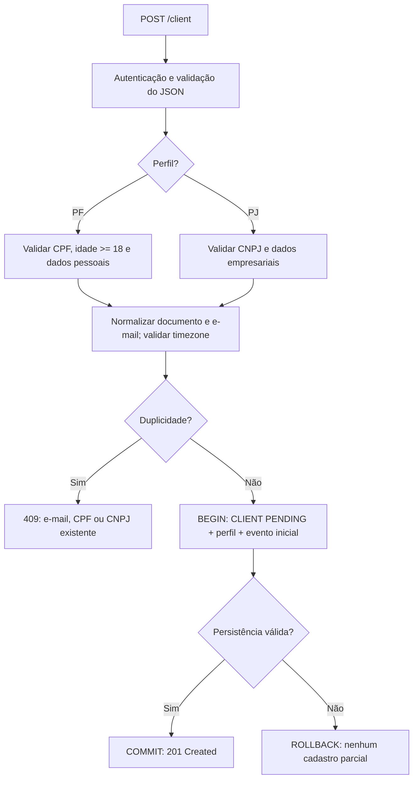

O `CLIENT_STATUS_EVENT` inicial registra `NULL → PENDING` com `actor_type=SYSTEM`. A especialização é exclusiva: `INDIVIDUAL_CLIENT` **ou** `COMPANY_CLIENT`. As restrições `UNIQUE` de e-mail, CPF e CNPJ protegem o banco mesmo diante de cadastros concorrentes.

### 2.3 R03 — Decisão cadastral por provedor externo

A API consulta o **Analysis Provider** e aplica sua resposta; o caller não envia `APPROVE` ou `REJECT` no body. A chamada externa é realizada **sem manter lock de escrita aberto**. Ao voltar do provedor, o serviço adquire lock do cliente e confirma novamente o estado `PENDING`.

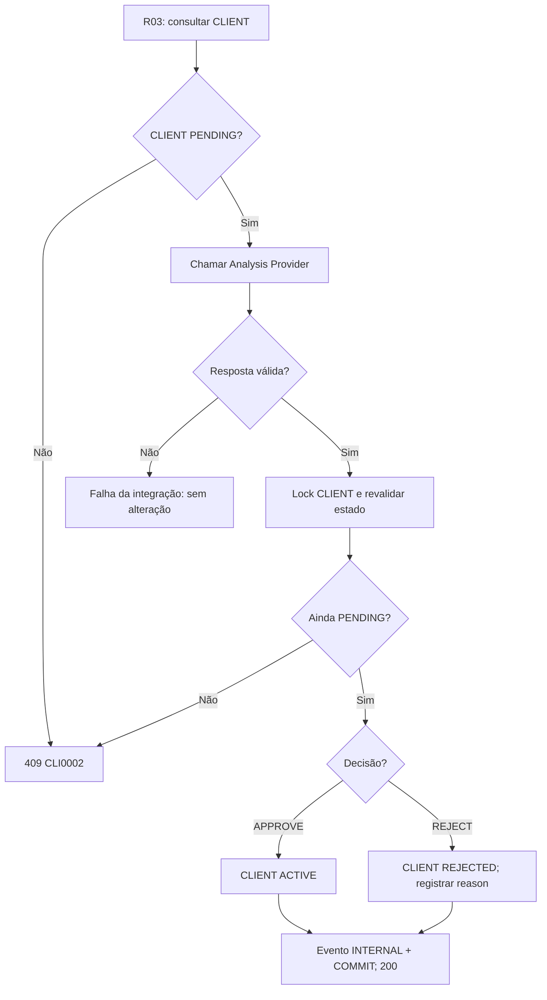

Em rejeição, o motivo válido retornado pelo provedor é armazenado no histórico. Uma nova análise só ocorre depois de uma transição `REJECTED → PENDING` via R09; não há limite arbitrário de ciclos.

### 2.4 R04 — Abertura de conta única

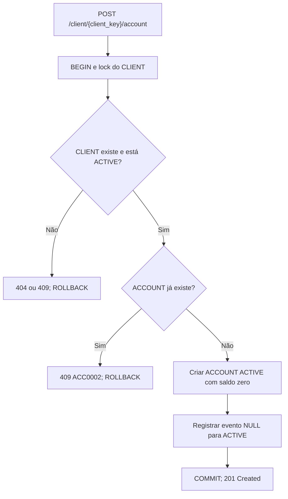

A restrição `UNIQUE(account.client_id)` assegura **no máximo uma conta por cliente durante toda a vida**, inclusive se a conta estiver `CLOSED`. Em duas aberturas concorrentes, o lock de `CLIENT` serializa a decisão: a primeira pode criar; a segunda encontra o vínculo existente e recebe conflito.

## 3. F02 — Ciclo de vida de clientes e contas

### 3.1 Estados do cliente

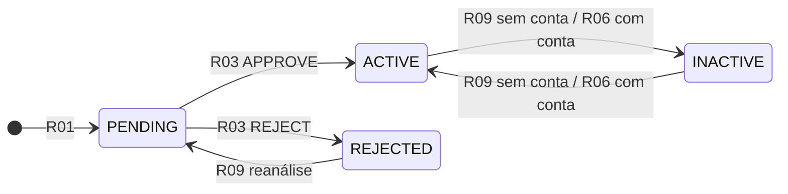

A R09 permite `REJECTED → PENDING` e `ACTIVE ↔ INACTIVE` **somente quando o cliente nunca possuiu conta**. A partir da existência de uma conta, as mudanças coordenadas de `ACTIVE ↔ INACTIVE` são responsabilidade da R06, mesmo que a conta esteja encerrada. Toda transição válida requer `reason` e registra `CLIENT_STATUS_EVENT` com `actor_type=INTERNAL`.

### 3.2 Estados da conta

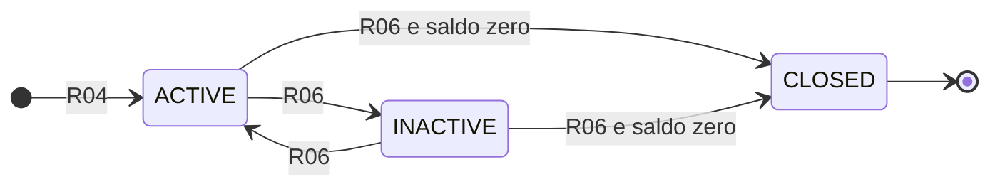

`CLOSED` é **terminal**: não admite reativação nem substituição por uma segunda conta. Encerramento requer `balance_cents = 0`; a R06 não executa movimentação financeira para zerar o saldo.

### 3.3 R06 — Transições coordenadas com histórico

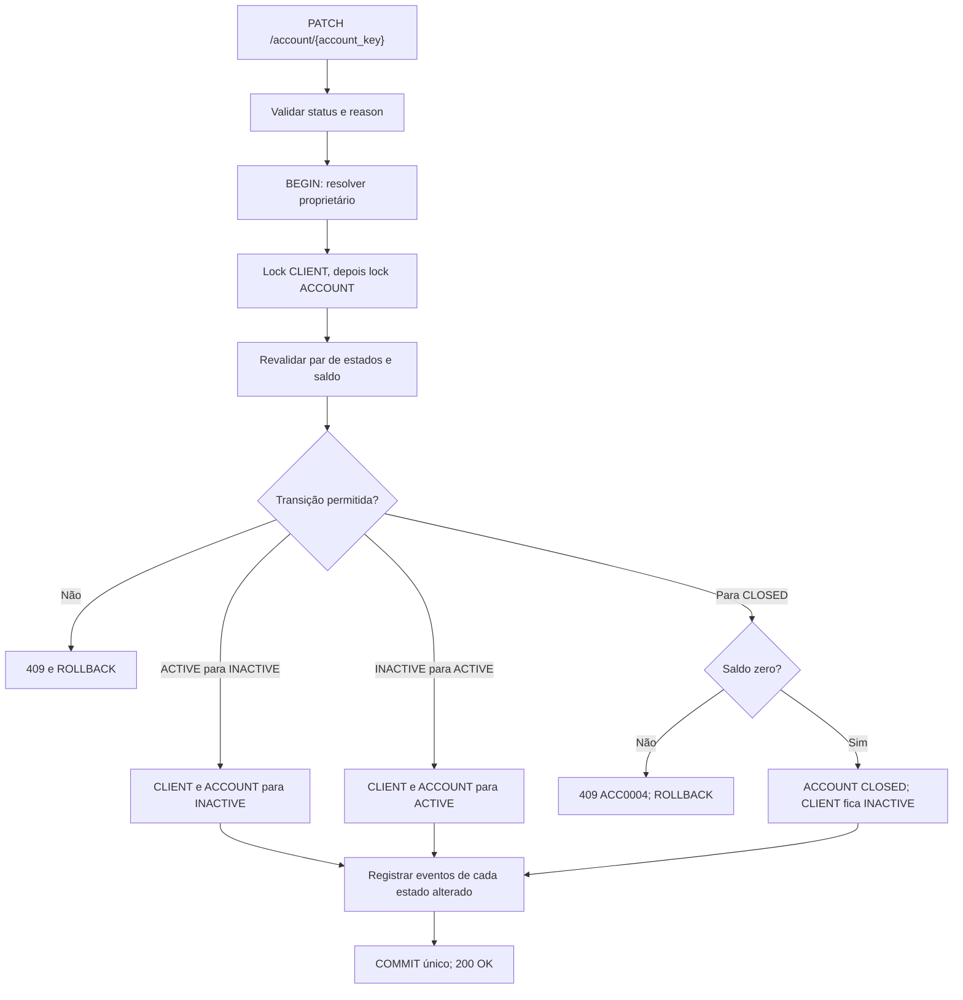

A transição `ACTIVE → CLOSED` altera também o cliente para `INACTIVE` e cria **dois eventos**. Na transição `INACTIVE → CLOSED`, o cliente já está `INACTIVE`: registra-se **apenas o evento da conta**, sem evento fictício `INACTIVE → INACTIVE`. O par cliente/conta é revalidado depois dos locks, evitando decisões a partir de estados desatualizados.

### 3.4 R09 — Reanálise e alterações sem conta

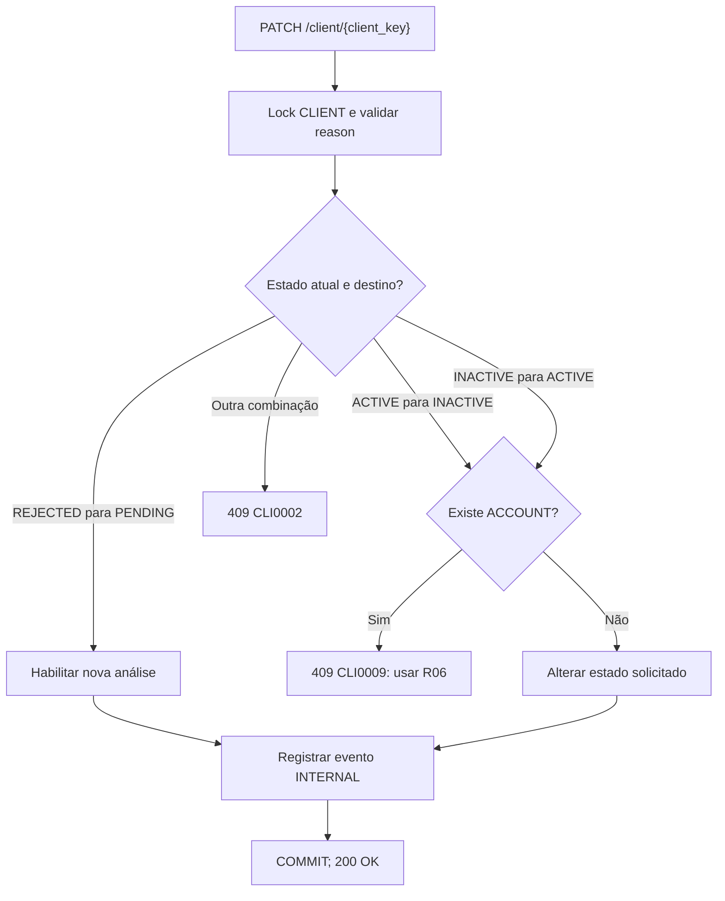

A ordem global de locks adotada pelo domínio é **CLIENT → ACCOUNT**. Isso coordena, por exemplo, a corrida entre R09 (inativação de cliente sem conta) e R04 (abertura de conta): somente uma condição válida pode ser confirmada; a outra operação revalida o estado e responde com conflito.

## 4. F03 — Depósitos e transferências (R07)

### 4.1 Regras financeiras

- **Header obrigatório:** `Idempotency-Key: <UUID>`. A chave não faz parte do body e é persistida como `financial_transaction.request_control_key`, com unicidade global.
- **Depósito:** `amount_cents >= 1`, sem tarifa; credita uma conta `ACTIVE` e cria um lançamento `CREDIT / PRINCIPAL`.
- **Transferência:** `amount_cents >= 1000` (R$ 10,00); origem e destino devem existir, ser distintos e estar `ACTIVE`. A origem precisa ter saldo para **principal + tarifa**.
- **Tarifa:** determinada exclusivamente pelo perfil do **cliente da origem**, com aritmética inteira, `HALF_UP` e limites mínimo/máximo.

| Perfil da origem | Percentual | Mínimo | Máximo |
|---|---:|---:|---:|
| Pessoa física (`INDIVIDUAL`) | 0,50% | 50 centavos | 1.000 centavos |
| Pessoa jurídica (`COMPANY`) | 1,00% | 100 centavos | 1.500 centavos |

O cálculo usa basis points (`50` para PF e `100` para PJ); a tarifa é calculada no servidor, não enviada pelo parceiro. Os saldos são inteiros `BIGINT`, sujeitos às restrições de faixa e não negatividade.

### 4.2 Idempotência — antes de aplicar efeitos financeiros

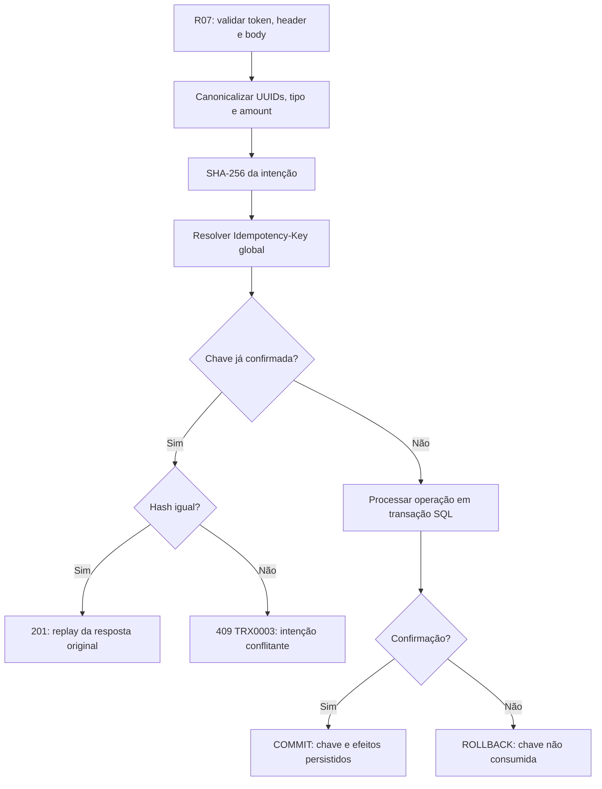

A intenção canônica é:

```text
DEPOSIT|{source_account_key}|{amount_cents}
TRANSFER|{source_account_key}|{target_account_key}|{amount_cents}
```

O SHA-256 não inclui JSON bruto, tarifa, timestamp nem a própria chave de idempotência. **Mesma chave + mesma intenção** retorna a transação original (`201`), sem segundo lançamento ou segunda tarifa, inclusive se o estado da conta tiver mudado depois do primeiro `COMMIT`. **Mesma chave + intenção diferente** retorna `409 TRX0003`. Uma operação abortada antes do `COMMIT` não consome a chave. A restrição `UNIQUE` do PostgreSQL protege também a disputa entre chamadas simultâneas com a mesma chave.

### 4.3 DEPOSIT — caminho feliz e falhas

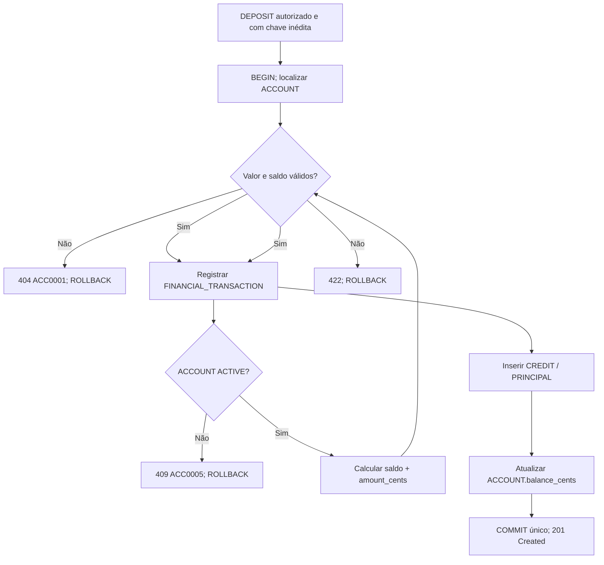

O depósito gera **uma operação e um lançamento**, com `fee_cents = 0`. A conta fica com saldo acrescido do valor depositado; o `balance_after_cents` registra o saldo após esse crédito.

### 4.4 TRANSFER — caminho feliz e falhas

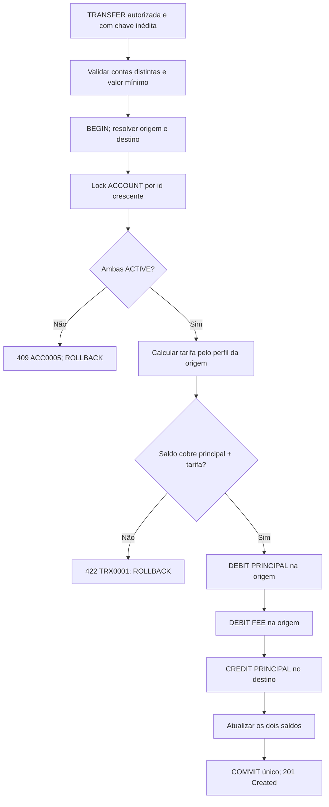

Cada transferência gera **uma `FINANCIAL_TRANSACTION` e três `TRANSACTION_ENTRY`** nessa ordem: débito de principal na origem, débito de tarifa na origem, crédito de principal no destino. A tarifa não reduz o crédito do destinatário.

**Exemplo — transferência PF de R$ 500,00:** origem com `100000` centavos, destino com `20000` centavos; valor `50000` e tarifa `250`. Após o principal, a origem registra saldo histórico `50000`; após a tarifa, `49750`. O destino recebe `50000` e passa a `70000`. Toda essa sequência confirma em um único `COMMIT`.

### 4.5 Concorrência, rollback e retentativas

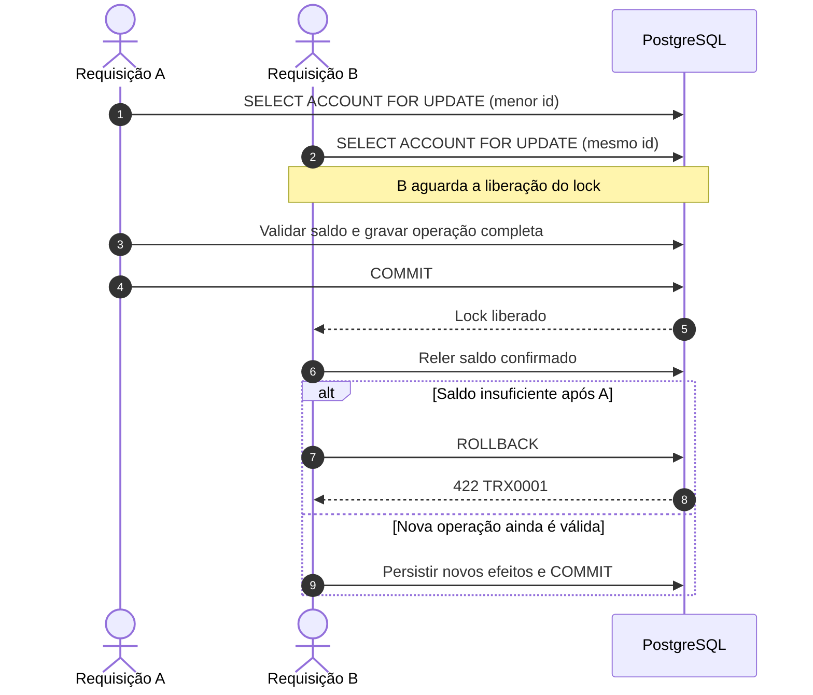

A aquisição de locks para transferências usa o **`ACCOUNT.id` em ordem crescente**, inclusive para transferências em sentidos opostos, reduzindo deadlocks por inversão de ordem. A revalidação de saldo após o lock impede que duas operações gastem o mesmo saldo.

**Atomicidade:** a transação financeira, os lançamentos de principal/tarifa, ambos os saldos e a chave de idempotência confirmam juntos. Uma falha antes do `COMMIT` desfaz tudo. Se o servidor confirmar a operação, mas a resposta HTTP se perder, o parceiro pode repetir **a mesma `Idempotency-Key` e a mesma intenção** para recuperar a resposta original sem movimentar novamente.

## 5. F04 — Extrato paginado (R08)

### 5.1 Consulta somente leitura

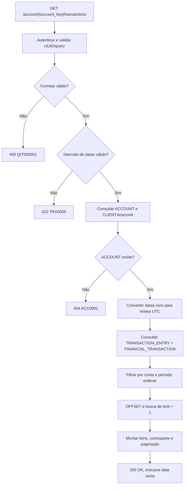

O extrato é consultado **por lançamento**, e não por operação inteira: um depósito gera um item; uma transferência apresenta dois itens na origem (`DEBIT / PRINCIPAL` e `DEBIT / FEE`) e um no destino (`CREDIT / PRINCIPAL`). O histórico pode ser lido em contas `ACTIVE`, `INACTIVE` ou `CLOSED`, sem `SELECT ... FOR UPDATE` nem modificações no banco.

### 5.2 Datas, ordenação e paginação

| Aspecto | Regra |
|---|---|
| Parâmetros | `page` (padrão `1`), `limit` (padrão `20`, máximo `100`), `order_by` (`asc`/`desc`) |
| Filtro temporal | `date_from` inclusiva; `date_to` inclusiva para o usuário e convertida em limite superior exclusivo |
| Timezone | Datas civis interpretadas pelo `CLIENT.timezone` do titular e convertidas para UTC |
| Ordenação | `FINANCIAL_TRANSACTION.created_at`, depois `FINANCIAL_TRANSACTION.id`, conforme `order_by`; `TRANSACTION_ENTRY.id ASC` como desempate |
| Próxima página | Buscar `limit + 1`; item extra determina `next_page`; não requer `COUNT(*)` |
| Resposta vazia | `200` com `data: []` e `next_page: null`, inclusive para página além do fim |

A contraparte é derivada dos lançamentos da operação: no débito principal aparece a conta de destino; no crédito principal, a origem; em tarifa e depósito, `null`. O timestamp público de cada item vem de `FINANCIAL_TRANSACTION.created_at`, retornado em UTC.

**Decisão de paginação:** uma fronteira de página pode separar principal e tarifa da mesma transferência. A opção `page`/`limit` é simples de consumir, mas não oferece snapshot imutável entre páginas quando novas operações são confirmadas; cursor/keyset pagination é uma alternativa para um produto de maior escala.

## 6. Consultas e liveness — R02, R05 e R10

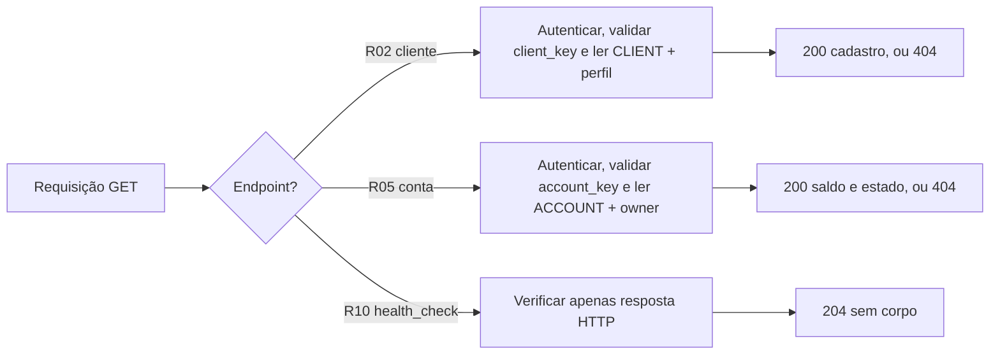

R02 e R05 não alteram cadastro, saldo ou histórico; as consultas retornam estados persistidos inclusive quando os recursos estão inativos ou encerrados. A R10 é pública e verifica **liveness HTTP**, não a disponibilidade do PostgreSQL ou do Analysis Provider.

## 7. Decisões de implementação e alternativas

| Decisão adotada | Alternativa considerada | Justificativa e trade-off |
|---|---|---|
| **Transações PostgreSQL únicas** para estado, histórico e operações financeiras | Commits separados por entidade | Um commit evita efeitos parciais; requer coordenação transacional e rollback explícito. |
| **Locks pessimistas e ordem de aquisição determinística** | Somente leitura/validação antes de escrever | Serializa decisões conflitantes sobre estado e saldo; introduz espera sob concorrência. |
| **Analysis Provider externo à transação de escrita** | Manter o lock durante a chamada HTTP | Evita segurar locks durante latência de rede; exige revalidar o estado depois da resposta. |
| **Idempotência global com UUID e SHA-256 canônico** | Apenas deduplicação do lado do parceiro | Resiste à perda de resposta e a tentativas concorrentes; precisa de unicidade e histórico persistido. |
| **Tarifa server-side diferenciada por PF/PJ** | Tarifa fixa ou informada no request | Centraliza pricing, evita manipulação pelo caller; há maior complexidade no arredondamento e nos limites. |
| **Extrato por `TRANSACTION_ENTRY` com `limit + 1`** | Agrupar por transação ou utilizar cursor | Mostra tarifa e saldo após cada efeito, sem `COUNT(*)`; páginas podem separar lançamentos e deslocar-se entre leituras. |
| **Lifecycle com eventos de status** | Alterar apenas a coluna de estado | Mantém rastreabilidade de transições; exige gravar o evento na mesma transação da alteração. |

## 8. Invariantes que conectam os fluxos

| Invariante | Garantia |
|---|---|
| Cadastro consistente | `CLIENT`, perfil PF/PJ e evento inicial confirmam juntos. |
| Conta única | `ACCOUNT.client_id UNIQUE`; encerramento não permite recriar conta. |
| Estado rastreável | Transição válida e evento correspondente no mesmo commit; sem evento de estado inalterado. |
| Conta encerrada | `CLOSED` é terminal e exige saldo zero. |
| Segurança financeira | Saldo não negativo; transferência só confirma com origem e destino válidos e saldo suficiente. |
| Idempotência | Chave global única; replay não repete principal, tarifa ou crédito. |
| Histórico financeiro | Operação, `TRANSACTION_ENTRY` e saldos confirmados de modo atômico. |
| Extrato coerente | Ordenação determinística; valores históricos lidos dos lançamentos, sem alterar recursos. |

O detalhamento de **campos, headers, respostas e códigos HTTP** está em [ROTAS.md](ROTAS.md). As **entidades, chaves, constraints e cardinalidades físicas** estão em [ERD.md](ERD.md). A [RFC](RFC.md) e sua [versão PDF](RFC.pdf) apresentam a motivação e a arquitetura da solução em formato resumido.
