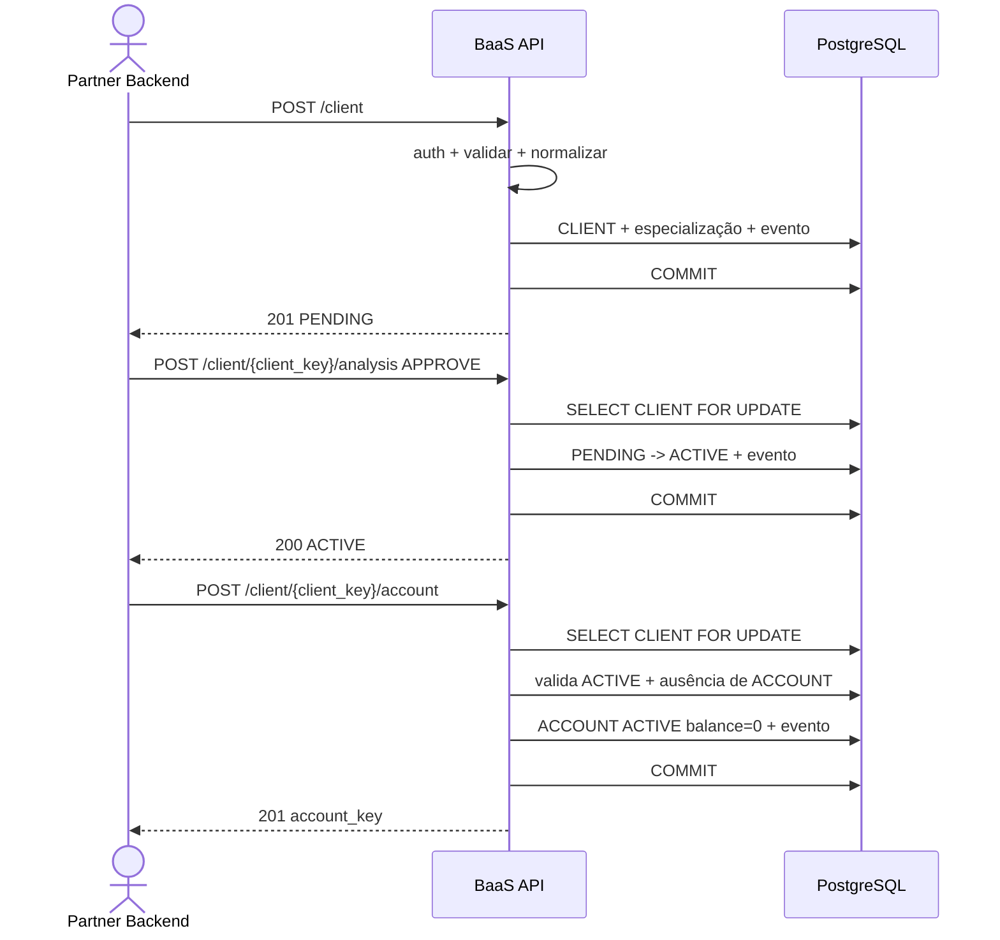
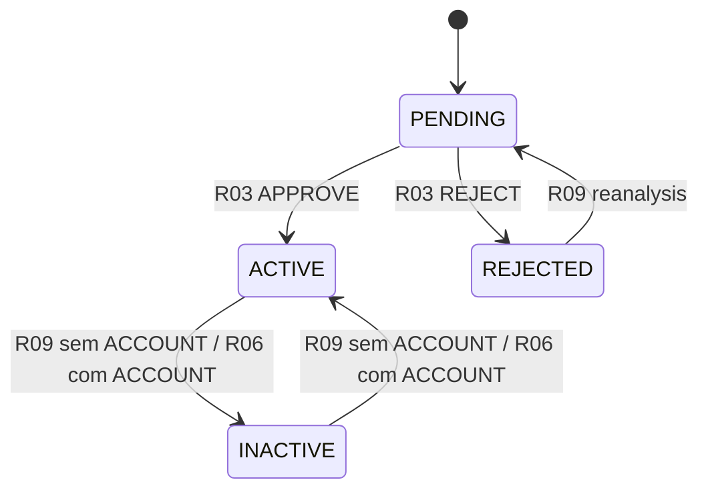
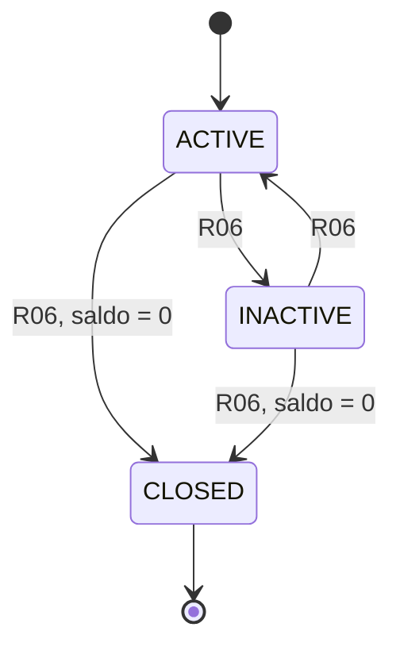
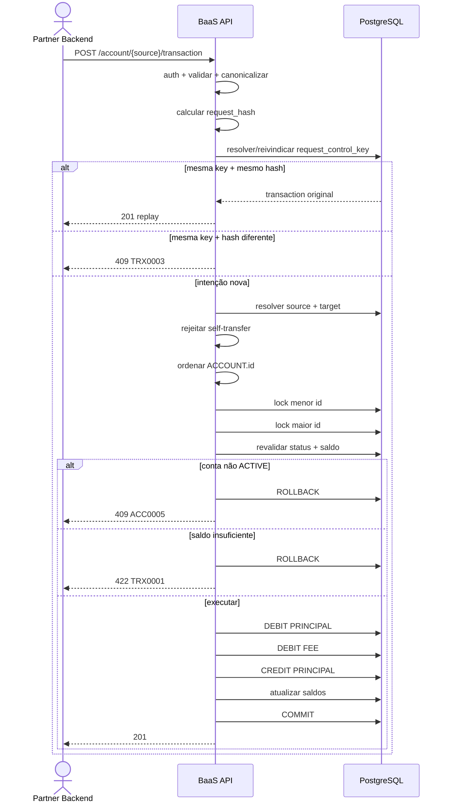

# Fluxos v1.1 — FINAL
## BaaS Simplificado — Bootcamp QI Tech 2026

**Time:** João Vitor + Moha  
**Data:** 06/10/2026  
**Versão:** 1.1  
**Status:** ✅ FINAL / AUDITADO / CONSOLIDADO / CONGELADO

---

# 0. Objetivo e fontes

Este documento consolida os fluxos internos finais do BaaS simplificado. O foco é a sequência entre `request` e `response`: validações, decisões, locks, persistência, `COMMIT`, `ROLLBACK` e caminhos de falha.

As referências versionadas para estes fluxos são o
[ERD v1.1](ERD_v1_1_FINAL_BaaS_QITech.md) e as
[Rotas v1.1 consolidadas](Rotas_v1_1_FINAL_CONSOLIDADA_BaaS_QITech.md).
Os contratos individuais R01–R10 e a versão anterior dos fluxos serviram
como material de elaboração, mas não integram a documentação versionada
deste repositório. Em caso de conflito com artefatos antigos, prevalece a
versão v1.1.

## [QI TECH — BOOTCAMP] Método adotado

```text
Request
↓
Validar
↓
Decidir: pode?
↓
Persistir / Ler
↓
Response
```

Um fluxo só é considerado completo quando demonstra o caminho feliz e pelo menos um caminho alternativo/de erro relevante. Quando há concorrência ou transação, também ficam explícitos locks, revalidação, `COMMIT` e `ROLLBACK`.

## Fluxos principais

```text
F01 — Onboarding do cliente
F02 — Lifecycle de CLIENT e ACCOUNT
F03 — Movimentação financeira
F04 — Extrato paginado
```

R02, R05 e R10 não recebem fluxo principal próprio porque são leituras/liveness simples já completamente especificadas nas rotas.

---

# 1. F01 — Onboarding do cliente

**Status:** ✅ FINAL / CONGELADO

## 1.1 Escopo

```text
R01 POST /client
R03 POST /client/{client_key}/analysis
R04 POST /client/{client_key}/account
```

Caminho feliz:

```text
CLIENT
NULL -> PENDING -> ACTIVE

ACCOUNT
inexistente -> ACTIVE
```

## 1.2 Cadastro — R01

Fluxo:

```text
POST /client
↓
validar INTERNAL-TOKEN
↓
validar schema/client_type
↓
normalizar email
↓
normalizar e validar CPF/CNPJ
↓
validar especialização PF/PJ
↓
validar CLIENT.timezone IANA brasileiro suportado
↓
se PF, validar idade >= 18
↓
verificar duplicidades conhecidas
↓
BEGIN
↓
gerar client_key
↓
INSERT CLIENT com PENDING
↓
INSERT exatamente uma especialização
↓
INSERT CLIENT_STATUS_EVENT
NULL -> PENDING
actor_type = SYSTEM
↓
COMMIT
↓
201
```

Normalizações relevantes:

```text
email -> trim + lowercase

CPF/CNPJ
-> aceitar canônico ou máscara convencional admitida
-> remover somente pontuação conhecida
-> validar dígitos verificadores
-> persistir somente dígitos

timezone
-> obrigatório
-> IANA
-> conjunto Brasil D0
-> sem inferência por IP/UF/CEP/endereço
```

Persistência atômica:

```text
CLIENT
+
INDIVIDUAL_CLIENT ou COMPANY_CLIENT
+
CLIENT_STATUS_EVENT
```

Invariante:

```text
não existe CLIENT parcialmente criado
```

## 1.3 Análise — R03

### APPROVE

```text
POST /client/{client_key}/analysis
↓
auth + validar key/body
↓
BEGIN
↓
SELECT CLIENT FOR UPDATE
↓
CLIENT existe?
├── não -> 404 CLI0001
└── sim
↓
CLIENT = PENDING?
├── não -> 409 CLI0002
└── sim
↓
PENDING -> ACTIVE
↓
UPDATE CLIENT
↓
INSERT CLIENT_STATUS_EVENT
PENDING -> ACTIVE
actor_type = INTERNAL
↓
COMMIT
↓
200 ACTIVE
```

`reason` é opcional em `APPROVE`.

### REJECT

```text
decision = REJECT
reason obrigatório
↓
CLIENT FOR UPDATE
↓
PENDING -> REJECTED
↓
UPDATE CLIENT
↓
INSERT CLIENT_STATUS_EVENT
actor_type = INTERNAL
reason normalizado
↓
COMMIT
↓
200 REJECTED
```

Depois de rejeitado:

```text
R09
REJECTED -> PENDING
```

Não existe limite máximo de reanálises.

## 1.4 Abertura de ACCOUNT — R04

Pré-condições:

```text
CLIENT existe
CLIENT = ACTIVE
CLIENT nunca possuiu ACCOUNT
```

Fluxo:

```text
POST /client/{client_key}/account
↓
auth + validar client_key
↓
BEGIN
↓
SELECT CLIENT FOR UPDATE
↓
CLIENT existe?
├── não -> 404 CLI0001
└── sim
↓
CLIENT = ACTIVE?
├── não -> 409 CLI0002
└── sim
↓
ACCOUNT já existe para client_id?
├── sim -> 409 ACC0002
└── não
↓
gerar account_key
↓
INSERT ACCOUNT
status = ACTIVE
balance_cents = 0
↓
INSERT ACCOUNT_STATUS_EVENT
NULL -> ACTIVE
actor_type = SYSTEM
↓
COMMIT
↓
201
```

Defesa estrutural final:

```text
ACCOUNT.client_id UNIQUE
```

## 1.5 Concorrência — duas aberturas

```text
A trava CLIENT
B aguarda

A cria ACCOUNT + evento
A COMMIT

B adquire lock
B revalida
ACCOUNT já existe
B -> 409 ACC0002
```

## 1.6 Falha — cadastro duplicado

Conflitos:

```text
email -> CLI0003
CPF   -> CLI0004
CNPJ  -> CLI0005
```

A pré-checagem ajuda a mensagem, mas a proteção definitiva é `UNIQUE`. Em qualquer falha antes do commit:

```text
ROLLBACK
```

sem cadastro parcial.

## 1.7 Diagrama F01



## 1.8 Invariantes F01

```text
CLIENT nasce PENDING
PENDING só vira ACTIVE/REJECTED pela R03
ACCOUNT só nasce para CLIENT ACTIVE
ACCOUNT nasce ACTIVE com balance_cents = 0
uma ACCOUNT por CLIENT durante toda a vida
eventos iniciais usam actor_type SYSTEM
mudança de estado + evento no mesmo COMMIT
reanálise sem limite máximo
erro não deixa persistência parcial
```

---

# 2. F02 — Lifecycle de CLIENT e ACCOUNT

**Status:** ✅ FINAL / CONGELADO

## 2.1 Escopo

```text
R09 PATCH /client/{client_key}
R06 PATCH /account/{account_key}
```

Responsabilidades:

```text
R09
-> REJECTED -> PENDING
-> ACTIVE <-> INACTIVE somente sem ACCOUNT

R06
-> lifecycle da ACCOUNT
-> coordena CLIENT + ACCOUNT
```

## 2.2 Máquinas de estado

### CLIENT



### ACCOUNT



`CLOSED` é terminal.

## 2.3 R09 — REJECTED -> PENDING

```text
PATCH /client/{client_key}
status = PENDING
reason obrigatório
↓
auth + validar
↓
BEGIN
↓
SELECT CLIENT FOR UPDATE
↓
estado = REJECTED?
├── não -> 409 CLI0002
└── sim
↓
UPDATE CLIENT -> PENDING
↓
INSERT CLIENT_STATUS_EVENT
REJECTED -> PENDING
actor_type = INTERNAL
↓
COMMIT
↓
200 PENDING
```

Não existe:

```text
reanalysis_count
limite de 3
limite máximo
```

## 2.4 Concorrência — duas reanálises

```text
A obtém lock
A REJECTED -> PENDING
A COMMIT

B obtém lock
B relê PENDING
B -> 409 CLI0002
```

Só um evento é criado.

## 2.5 R09 — ACTIVE <-> INACTIVE sem ACCOUNT

Inativação:

```text
CLIENT ACTIVE
sem ACCOUNT
↓
CLIENT FOR UPDATE
↓
confirmar ausência de ACCOUNT
↓
ACTIVE -> INACTIVE
↓
evento INTERNAL
↓
COMMIT
```

Reativação:

```text
CLIENT INACTIVE
sem ACCOUNT
↓
CLIENT FOR UPDATE
↓
confirmar ausência de ACCOUNT
↓
INACTIVE -> ACTIVE
↓
evento INTERNAL
↓
COMMIT
```

Se qualquer ACCOUNT já existe:

```text
409 CLI0009
```

Isso inclui ACCOUNT `ACTIVE`, `INACTIVE` ou `CLOSED`.

## 2.6 Concorrência — R09 vs R04

Estado:

```text
CLIENT ACTIVE
sem ACCOUNT
```

Se R09 vencer:

```text
CLIENT -> INACTIVE
COMMIT
R04 relê INACTIVE
-> 409
```

Se R04 vencer:

```text
ACCOUNT é criada
COMMIT
R09 detecta ACCOUNT
-> 409 CLI0009
```

## 2.7 R06 — ordem global de locks

Como a rota recebe `account_key`:

```text
BEGIN
↓
resolver owner/client_id
↓
lock CLIENT
↓
lock ACCOUNT
↓
revalidar estados e saldo
```

A decisão final sempre usa os valores revalidados após os locks.

## 2.8 R06 — ACTIVE -> INACTIVE

Pré-condição:

```text
CLIENT ACTIVE
ACCOUNT ACTIVE
```

Persistência:

```text
ACCOUNT ACTIVE -> INACTIVE
CLIENT  ACTIVE -> INACTIVE
ACCOUNT_STATUS_EVENT
CLIENT_STATUS_EVENT
actor_type = INTERNAL
reason obrigatório
```

Tudo em um único `COMMIT`.

## 2.9 R06 — INACTIVE -> ACTIVE

Pré-condição:

```text
CLIENT INACTIVE
ACCOUNT INACTIVE
```

Persistência:

```text
CLIENT  INACTIVE -> ACTIVE
ACCOUNT INACTIVE -> ACTIVE
dois eventos INTERNAL
um COMMIT
```

## 2.10 R06 — ACTIVE -> CLOSED

Pré-condição:

```text
CLIENT ACTIVE
ACCOUNT ACTIVE
balance_cents = 0
```

Persistência:

```text
ACCOUNT ACTIVE -> CLOSED
CLIENT  ACTIVE -> INACTIVE
ACCOUNT_STATUS_EVENT
CLIENT_STATUS_EVENT
COMMIT
```

## 2.11 R06 — INACTIVE -> CLOSED

Pré-condição:

```text
CLIENT INACTIVE
ACCOUNT INACTIVE
balance_cents = 0
```

Persistência:

```text
ACCOUNT INACTIVE -> CLOSED
CLIENT permanece INACTIVE
somente ACCOUNT_STATUS_EVENT
COMMIT
```

Não criar:

```text
CLIENT_STATUS_EVENT INACTIVE -> INACTIVE
```

## 2.12 Falha — saldo impede CLOSED

```text
target = CLOSED
balance_cents != 0
↓
nenhuma mudança
nenhum evento
ROLLBACK
409 ACC0004
```

R06 não zera saldo e não cria transação financeira.

## 2.13 Falha — CLOSED tentando mudar

```text
ACCOUNT = CLOSED
↓
qualquer nova transição
-> 409 ACC0003
```

Sem update/evento.

## 2.14 Falha — par CLIENT/ACCOUNT incoerente

Exemplos:

```text
ACCOUNT ACTIVE + CLIENT INACTIVE
ACCOUNT INACTIVE + CLIENT ACTIVE
```

A rota não corrige silenciosamente:

```text
409 CLI0002
```

Corrupção estrutural não explicável por regra de domínio:

```text
500 QIT000500
```

## 2.15 Diagrama F02

```mermaid
flowchart TD
    A[PATCH /account/{account_key}] --> B[Auth + validar status/reason]
    B --> C[BEGIN]
    C --> D[Resolver CLIENT owner]
    D --> E[Lock CLIENT]
    E --> F[Lock ACCOUNT]
    F --> G[Revalidar estados + saldo]
    G --> H{Destino}

    H -- INACTIVE --> I{ACTIVE/ACTIVE?}
    I -- Não --> X[409]
    I -- Sim --> J[ACCOUNT -> INACTIVE]
    J --> K[CLIENT -> INACTIVE]
    K --> L[Inserir eventos]
    L --> M[COMMIT]

    H -- ACTIVE --> N{INACTIVE/INACTIVE?}
    N -- Não --> X
    N -- Sim --> O[CLIENT -> ACTIVE]
    O --> P[ACCOUNT -> ACTIVE]
    P --> L

    H -- CLOSED --> Q{balance = 0?}
    Q -- Não --> R[409 ACC0004 + ROLLBACK]
    Q -- Sim --> S[ACCOUNT -> CLOSED]
    S --> T{CLIENT estava ACTIVE?}
    T -- Sim --> U[CLIENT -> INACTIVE + evento]
    T -- Não --> V[CLIENT permanece INACTIVE]
    U --> W[Inserir ACCOUNT event]
    V --> W
    W --> M
```

## 2.16 Invariantes F02

```text
CLOSED terminal
CLOSED somente com balance_cents = 0
R09 ACTIVE <-> INACTIVE somente sem ACCOUNT
com ACCOUNT -> R06
REJECTED -> PENDING sem limite máximo
R03 decide PENDING -> ACTIVE/REJECTED
CLIENT lock antes de ACCOUNT
estado + eventos reais no mesmo COMMIT
sem evento from_status == to_status
falha não deixa lifecycle parcial
```


---

# 3. F03 — Movimentação financeira

**Status:** ✅ FINAL / CONGELADO  
**Core do desafio**

## 3.1 Escopo

F03 detalha:

```text
R07 POST /account/{account_key}/transaction
```

Tipos suportados:

```text
DEPOSIT
TRANSFER
```

Objetivo:

```text
saldo consistente
+
tarifa
+
histórico financeiro
+
idempotência
+
concorrência
+
atomicidade
```

Modelo:

```text
FINANCIAL_TRANSACTION
+
TRANSACTION_ENTRY
+
ACCOUNT.balance_cents
```

Não é um full double-entry ledger.

## 3.2 Invariantes financeiras

```text
amount_cents >= 1

somente ACCOUNT ACTIVE executa nova movimentação

balance_cents nunca fica negativo

TRANSFER:
source != target
fee_cents = 200
source.balance_cents >= amount_cents + 200

DEPOSIT:
fee_cents = 0

FINANCIAL_TRANSACTION + ENTRYs + saldos
-> mesmo COMMIT

falha antes do COMMIT
-> ROLLBACK total
```

## 3.3 Idempotency gate

Toda intenção recebe:

```text
request_control_key UUID
UNIQUE GLOBAL
```

Também é calculado:

```text
request_hash SHA-256
```

### Canonicalização

Antes do hash:

```text
UUIDs
-> parsear
-> serializar lowercase com hífens

transaction_type
-> enum canônico

amount_cents
-> inteiro decimal canônico
```

### Hash DEPOSIT

```text
DEPOSIT|source_account_key|amount_cents
```

### Hash TRANSFER

```text
TRANSFER|source_account_key|target_account_key|amount_cents
```

Não entram:

```text
fee_cents
request_id
timestamp HTTP
JSON bruto
ordem textual do JSON
transaction_key
created_at
```

### Resultado do gate

```text
key nova
-> executa uma vez

mesma key + mesmo hash
-> replay da transaction original
-> sem novo efeito
-> mesmo transaction_key
-> 201

mesma key + hash diferente
-> 409 TRX0003
```

## 3.4 Replay depois de mudança de lifecycle

Se a operação já foi commitada:

```text
mesma key + mesmo hash
```

continua sendo replay mesmo se depois a conta tiver virado:

```text
INACTIVE
CLOSED
```

Resultado:

```text
201 original
```

Sem nova movimentação e sem nova validação de saldo/lifecycle para executar dinheiro novamente.

## 3.5 Falha não consome a key

A reserva idempotente pertence à mesma transação PostgreSQL.

```text
falha antes do COMMIT
↓
ROLLBACK
↓
FINANCIAL_TRANSACTION não confirma
↓
request_control_key não fica consumida
```

## 3.6 Race da mesma request_control_key

Duas requests simultâneas:

```text
A key = X
B key = X
```

Uma consulta prévia isolada não basta.

Garantia final:

```text
UNIQUE(request_control_key)
```

Somente uma intenção financeira pode ficar commitada com a mesma key.

Depois da disputa:

```text
mesmo hash
-> replay

hash diferente
-> 409 TRX0003
```

## 3.7 DEPOSIT — caminho feliz

Request:

```json
{
  "request_control_key": "...",
  "transaction_type": "DEPOSIT",
  "amount_cents": 10000
}
```

Semântica:

```text
account_key do path
-> conta que recebe o crédito
```

Fluxo:

```text
POST /account/{account_key}/transaction
↓
validar INTERNAL-TOKEN
↓
validar key/body
↓
amount é inteiro?
├── não -> 400 QIT000001
└── sim
↓
amount >= 1?
├── não -> 422 TRX0004
└── sim
↓
canonicalizar intenção
↓
calcular request_hash
↓
BEGIN
↓
resolver/reivindicar request_control_key
↓
replay?
├── sim -> 201 original
└── não
↓
hash conflitante?
├── sim -> 409 TRX0003
└── não
↓
resolver ACCOUNT
↓
existe?
├── não -> 404 ACC0001 + ROLLBACK
└── sim
↓
SELECT ACCOUNT FOR UPDATE
↓
revalidar ACCOUNT = ACTIVE
├── não -> 409 ACC0005 + ROLLBACK
└── sim
↓
new_balance = old_balance + amount
↓
confirmar FINANCIAL_TRANSACTION DEPOSIT
↓
INSERT TRANSACTION_ENTRY
CREDIT / PRINCIPAL
balance_after = new_balance
↓
UPDATE ACCOUNT.balance_cents
↓
COMMIT
↓
201
```

Efeito:

```text
1 CREDIT / PRINCIPAL
fee_cents = 0
```

## 3.8 TRANSFER — caminho feliz

Request:

```json
{
  "request_control_key": "...",
  "transaction_type": "TRANSFER",
  "amount_cents": 10000,
  "target_account_key": "..."
}
```

Semântica:

```text
path account_key
-> source

target_account_key
-> target
```

Fluxo:

```text
auth
↓
validar keys/body
↓
amount inteiro?
├── não -> 400
└── sim
↓
amount >= 1?
├── não -> 422 TRX0004
└── sim
↓
canonicalizar
↓
request_hash
↓
BEGIN / idempotency gate
↓
replay?
├── sim -> 201 original
└── não
↓
hash conflitante?
├── sim -> 409 TRX0003
└── não
↓
resolver source + target
↓
alguma não existe?
├── sim -> 404 ACC0001 + ROLLBACK
└── não
↓
source == target?
├── sim -> 409 TRX0002 + ROLLBACK
└── não
↓
ordenar por ACCOUNT.id
↓
lock menor id
↓
lock maior id
↓
revalidar source ACTIVE
↓
revalidar target ACTIVE
↓
alguma não ACTIVE?
├── sim -> 409 ACC0005 + ROLLBACK
└── não
↓
fee_cents = 200
↓
source.balance >= amount + fee?
├── não -> 422 TRX0001 + ROLLBACK
└── sim
↓
calcular balances_after
↓
persistir entries na ordem congelada
↓
atualizar saldos
↓
COMMIT
↓
201
```

## 3.9 Ordem histórica da TRANSFER

```text
1. source -> DEBIT  / PRINCIPAL
2. source -> DEBIT  / FEE
3. target -> CREDIT / PRINCIPAL
```

Exemplo:

```text
source antes = 20000
target antes = 5000
amount = 10000
fee = 200
```

Resultado:

```text
Entry 1
source DEBIT / PRINCIPAL
balance_after = 10000

Entry 2
source DEBIT / FEE
balance_after = 9800

Entry 3
target CREDIT / PRINCIPAL
balance_after = 15000
```

Saldos finais:

```text
source = 9800
target = 15000
```

## 3.10 Invariante saldo/extrato

Após a última entry da conta e antes da próxima movimentação:

```text
último TRANSACTION_ENTRY.balance_after_cents
=
ACCOUNT.balance_cents
```

## 3.11 Atomicidade da TRANSFER

Confirmam juntos:

```text
FINANCIAL_TRANSACTION
source DEBIT / PRINCIPAL
source DEBIT / FEE
target CREDIT / PRINCIPAL
source.balance_cents
target.balance_cents
```

Nunca pode persistir:

```text
source debitada sem target creditado
principal sem fee
entry sem saldo correspondente
FINANCIAL_TRANSACTION sem entries completas
```

Falha:

```text
ROLLBACK integral
```

## 3.12 Falha — saldo insuficiente

Condição:

```text
source.balance_cents < amount_cents + 200
```

A checagem ocorre após os locks.

Resultado:

```text
nenhum saldo novo
nenhuma entry confirmada
nenhuma FINANCIAL_TRANSACTION confirmada
request_control_key não consumida
422 TRX0001
```

## 3.13 Falha — ACCOUNT não ACTIVE

DEPOSIT:

```text
conta receptora INACTIVE/CLOSED
-> 409 ACC0005
```

TRANSFER:

```text
source ou target INACTIVE/CLOSED
-> 409 ACC0005
```

Status é revalidado após lock.

## 3.14 Falha — self-transfer

```text
source == target
```

Resultado:

```text
409 TRX0002
```

Sem débito, fee, crédito ou histórico financeiro.

## 3.15 Retry — resposta perdida depois do COMMIT

Cenário:

```text
COMMIT aconteceu
↓
201 se perdeu no transporte
```

Caller repete a mesma key/intenção.

API:

```text
recalcula mesmo hash
↓
encontra transaction original
↓
não movimenta de novo
↓
não cobra fee de novo
↓
retorna mesma resposta lógica
↓
201
```

## 3.16 Concorrência — duas TRANSFERs gastando a mesma source

Saldo:

```text
15000
```

A:

```text
10000 + 200
```

B:

```text
10000 + 200
```

Execução:

```text
A obtém lock
A relê 15000
A executa
A COMMIT
saldo = 4800

B obtém lock
B relê 4800
4800 < 10200
B -> 422 TRX0001
```

Invariante:

```text
saldo compartilhado não é gasto duas vezes
```

## 3.17 Concorrência — TRANSFERs em sentidos opostos

```text
A: conta 10 -> conta 20
B: conta 20 -> conta 10
```

Ambas tentam:

```text
lock 10
↓
lock 20
```

e não `source -> target`.

Isso reduz risco de deadlock por inversão de locks.

## 3.18 Diagrama F03



## 3.19 Imutabilidade

Após COMMIT:

```text
FINANCIAL_TRANSACTION
TRANSACTION_ENTRY
```

são append-only.

Reversão futura:

```text
nova operação compensatória
```

`REVERSAL` está fora do D0.

## 3.20 Invariantes F03

```text
uma key commitada identifica uma intenção financeira

mesma key + mesmo hash não movimenta duas vezes

mesma key + hash diferente é conflito

falha pré-commit não consome key

UUIDs entram no hash canonicalizadas

DEPOSIT gera CREDIT / PRINCIPAL

TRANSFER gera PRINCIPAL -> FEE -> crédito target

fee_cents = 200

source cobre principal + fee

saldo nunca fica negativo

somente ACCOUNT ACTIVE executa nova movimentação

self-transfer é rejeitada

duas contas são lockadas por id crescente

tudo confirma em um COMMIT

histórico financeiro é append-only
```


---

# 4. F04 — Extrato paginado

**Status:** ✅ FINAL / CONGELADO

## 4.1 Escopo

F04 detalha:

```text
R08 GET /account/{account_key}/transactions
```

Objetivo:

```text
consultar histórico financeiro
sem alterar estado
sem lock de escrita
com filtros temporais
paginação
ordenação determinística
```

Unidade pública:

```text
1 item
=
1 TRANSACTION_ENTRY
```

Consequência:

```text
DEPOSIT
-> 1 item

TRANSFER na source
-> DEBIT / PRINCIPAL
-> DEBIT / FEE

TRANSFER no target
-> CREDIT / PRINCIPAL
```

## 4.2 Entrada e defaults

Path:

```text
account_key UUID
```

Query params opcionais:

```text
page
limit
order_by
date_from
date_to
```

Defaults:

```text
page = 1
limit = 20
order_by = desc
```

Restrições:

```text
page >= 1
1 <= limit <= 100
order_by = asc | desc
```

Datas:

```text
YYYY-MM-DD
```

## 4.3 Taxonomia de validação

Contrato/formato inválido:

```text
account_key malformada
page não inteiro
page < 1
limit não inteiro
limit < 1
limit > 100
order_by inválido
date_from com formato inválido
date_to com formato inválido
```

Resultado:

```text
400 QIT000001
```

Combinação semanticamente inválida:

```text
date_from > date_to
```

Resultado:

```text
422 TRX0005
```

## 4.4 Semântica temporal v1.1

`date_from` e `date_to` são datas civis locais interpretadas em:

```text
CLIENT.timezone
```

do proprietário da ACCOUNT.

Não existe timezone fixo global para a rota.

Fluxo:

```text
data civil
↓
CLIENT.timezone
↓
início local do dia
↓
datetime timezone-aware
↓
converter para UTC
↓
comparar com TIMESTAMPTZ
```

### date_from

Inclusivo:

```text
FINANCIAL_TRANSACTION.created_at >= lower_bound_utc
```

### date_to

Inclusivo para o caller, implementado como:

```text
FINANCIAL_TRANSACTION.created_at < início local do dia seguinte convertido para UTC
```

Modelo:

```text
[lower_bound, upper_bound)
```

Somente `date_from`:

```text
sem upper bound
```

Somente `date_to`:

```text
sem lower bound
```

## 4.5 Timestamp público

Cada item expõe:

```text
FINANCIAL_TRANSACTION.created_at
```

e não o timestamp técnico da entry.

Resposta:

```text
UTC
RFC3339
Z
```

## 4.6 Caminho feliz

```text
GET /account/{account_key}/transactions
↓
validar INTERNAL-TOKEN
↓
validar account_key e query
↓
aplicar defaults
↓
ACCOUNT existe?
├── não -> 404 ACC0001
└── sim
↓
resolver CLIENT owner
↓
obter CLIENT.timezone
↓
converter datas civis, se houver
↓
consultar TRANSACTION_ENTRY + FINANCIAL_TRANSACTION
↓
filtrar account_id
↓
filtrar por FINANCIAL_TRANSACTION.created_at
↓
ordenar deterministicamente
↓
OFFSET = (page - 1) * limit
↓
buscar limit + 1
↓
montar primeiros limit itens
↓
derivar counterparty
↓
calcular next_page
↓
200
```

A ACCOUNT pode estar:

```text
ACTIVE
INACTIVE
CLOSED
```

Lifecycle restringe nova movimentação, não leitura histórica.

## 4.7 Ordenação determinística

DESC:

```text
FINANCIAL_TRANSACTION.created_at DESC
FINANCIAL_TRANSACTION.id         DESC
TRANSACTION_ENTRY.id             ASC
```

ASC:

```text
FINANCIAL_TRANSACTION.created_at ASC
FINANCIAL_TRANSACTION.id         ASC
TRANSACTION_ENTRY.id             ASC
```

Dentro da mesma TRANSFER na source:

```text
PRINCIPAL
↓
FEE
```

permanece nessa ordem tanto em `asc` quanto em `desc`.

## 4.8 Item público

```json
{
  "transaction_key": "...",
  "transaction_type": "TRANSFER",
  "entry_type": "PRINCIPAL",
  "direction": "DEBIT",
  "amount_cents": 10000,
  "balance_after_cents": 90000,
  "counterparty_account_key": "...",
  "created_at": "2026-10-01T20:15:00Z"
}
```

Campos:

```text
transaction_key
transaction_type
entry_type
direction
amount_cents
balance_after_cents
counterparty_account_key
created_at
```

## 4.9 Counterparty derivada

```text
TRANSFER / PRINCIPAL / DEBIT
-> target_account_key

TRANSFER / PRINCIPAL / CREDIT
-> source_account_key

TRANSFER / FEE
-> null

DEPOSIT
-> null
```

Não é duplicada em `TRANSACTION_ENTRY`.

## 4.10 Paginação sem COUNT obrigatório

Estratégia:

```text
limit = N
↓
buscar N + 1
```

Se existe item extra:

```text
next_page = current_page + 1
```

Caso contrário:

```text
next_page = null
```

Envelope:

```json
{
  "data": [],
  "pagination": {
    "current_page": 1,
    "next_page": null,
    "rows_per_page": 20
  }
}
```

`rows_per_page`:

```text
limit efetivo
```

e não `len(data)`.

Não exige:

```text
COUNT(*)
total_items
total_pages
```

## 4.11 Alternativo — conta sem movimentações

```text
ACCOUNT existe
sem entries
↓
200
data = []
next_page = null
```

Não é `404`.

## 4.12 Alternativo — página além do fim

```text
ACCOUNT existe
page válida
offset sem registros
↓
200
data = []
next_page = null
current_page = page solicitada
```

## 4.13 Fronteira de página

Como:

```text
1 item = 1 TRANSACTION_ENTRY
```

uma fronteira pode separar:

```text
página N:
PRINCIPAL

página N+1:
FEE da mesma transaction
```

Isso é aceito no D0.

Evitar o split exigiria mudar a unidade de paginação ou permitir páginas de tamanho variável.

## 4.14 Paginação e concorrência

A ordenação é determinística para o mesmo estado do banco.

Porém:

```text
page + limit
```

não garante snapshot entre requests.

Exemplo:

```text
GET página 1
↓
nova transaction commitada
↓
GET página 2
```

As posições podem deslocar.

Trade-off aceito no D0.

Cursor/keyset pagination:

```text
fora do D0
```

## 4.15 Falha — ACCOUNT inexistente

```text
UUID válida
+
ACCOUNT inexistente
↓
404 ACC0001
```

Sem lock de escrita.

## 4.16 Leitura sem side effects

F04 não executa:

```text
INSERT
UPDATE
DELETE
SELECT ... FOR UPDATE
COMMIT de regra de negócio
```

`balance_after_cents` é lido do histórico, não reconstruído.

## 4.17 Índice físico

A v1.1 não congela índice específico da R08.

Processo:

```text
implementar query real
↓
EXPLAIN
↓
analisar plano
↓
definir índice
↓
atualizar database/database.sql
```

Não mudar o contrato apenas para aproveitar índice preliminar antigo.

## 4.18 Diagrama F04

```mermaid
flowchart TD
    A[GET /account/{account_key}/transactions] --> B[Validar INTERNAL-TOKEN]
    B --> C[Validar key/query]
    C --> D{Contrato válido?}
    D -- Não --> E[400 QIT000001]
    D -- Sim --> F{date_from <= date_to?}
    F -- Não --> G[422 TRX0005]
    F -- Sim --> H{ACCOUNT existe?}
    H -- Não --> I[404 ACC0001]
    H -- Sim --> J[Resolver CLIENT.timezone]
    J --> K[Converter filtros para UTC]
    K --> L[Consultar TE + FT]
    L --> M[Ordenar deterministicamente]
    M --> N[OFFSET + LIMIT+1]
    N --> O[Derivar counterparty]
    O --> P[Montar pagination]
    P --> Q[200 OK]
```

## 4.19 Invariantes F04

```text
extrato é somente leitura

1 item = 1 TRANSACTION_ENTRY

ACCOUNT ACTIVE/INACTIVE/CLOSED é legível

principal e fee permanecem separados

timestamp público = FINANCIAL_TRANSACTION.created_at

date_from/date_to usam CLIENT.timezone

date_to inclusivo via intervalo semiaberto

resposta timestamp = UTC/Z

query inválida estruturalmente -> 400

date_from > date_to -> 422 TRX0005

counterparty é derivada

page default = 1

limit default = 20

limit max = 100

rows_per_page = limit efetivo

limit + 1 define next_page

sem COUNT obrigatório

extrato vazio -> 200 []

página além do fim -> 200 []

página pode separar PRINCIPAL e FEE

sem SELECT FOR UPDATE

índice final via query real + EXPLAIN
```

---

# 5. Auditoria v1 -> v1.1

A versão v1 foi comparada contra:

```text
ERD v1.1 FINAL
Rotas v1.1 FINAL CONSOLIDADA
```

As mudanças materiais estão abaixo.

## 5.1 Reanálise

Removido:

```text
limite de três reanálises
contagem de eventos para bloquear a quarta
```

Agora:

```text
REJECTED -> PENDING
sem limite máximo no D0
```

O histórico continua append-only.

## 5.2 Timezone do extrato

Removido:

```text
America/Sao_Paulo fixo
```

Agora:

```text
CLIENT.timezone
```

da conta consultada.

## 5.3 400 vs 422 na R08

Agora:

```text
query/formato inválido
-> 400 QIT000001

date_from > date_to
-> 422 TRX0005
```

## 5.4 Canonicalização da idempotência

F03 passa a explicitar:

```text
UUID canônica lowercase/hífen
transaction_type canônico
amount_cents inteiro decimal
```

antes do SHA-256.

## 5.5 Replay após mudança de estado

Depois de operação financeira confirmada:

```text
mesma key + mesmo hash
-> replay original
```

mesmo se a conta depois ficar `INACTIVE` ou `CLOSED`.

## 5.6 Novos códigos consolidados

```text
CLI0009
-> lifecycle direto bloqueado porque existe ACCOUNT

ACC0005
-> ACCOUNT não ACTIVE para movimentação

TRX0004
-> amount_cents < 1

TRX0005
-> date_from > date_to
```

## 5.7 Paginação por entry

Agora fica explícito:

```text
PRINCIPAL e FEE podem cair em páginas diferentes
```

porque a unidade é `TRANSACTION_ENTRY`.

## 5.8 Índice do extrato

O índice preliminar antigo não é mais tratado como aprovado.

Decisão:

```text
query real + EXPLAIN
-> índice definitivo
```

## 5.9 Timezone no onboarding

F01 passa a explicitar:

```text
timezone obrigatório em R01
sem inferência
sem fallback automático
```

---

# 6. Validação cruzada final

## F01

```text
R01 cadastro PF/PJ                     ✅
timezone obrigatório                   ✅
idade >= 18                            ✅
CLIENT nasce PENDING                   ✅
evento NULL -> PENDING SYSTEM          ✅
R03 PENDING -> ACTIVE/REJECTED          ✅
R04 somente CLIENT ACTIVE              ✅
uma ACCOUNT por CLIENT                 ✅
ACCOUNT nasce ACTIVE saldo 0           ✅
atomicidade                            ✅
concorrência de abertura               ✅
```

## F02

```text
R09 REJECTED -> PENDING                ✅
reanálise sem limite                   ✅
R09 ACTIVE <-> INACTIVE sem ACCOUNT    ✅
com ACCOUNT lifecycle via R06          ✅
CLI0009                                ✅
CLIENT -> ACCOUNT lock order           ✅
CLOSED terminal                        ✅
CLOSED somente saldo 0                 ✅
sem evento falso                       ✅
atomicidade lifecycle + eventos        ✅
```

## F03

```text
DEPOSIT                                ✅
TRANSFER                               ✅
amount >= 1                            ✅
fee = 200                              ✅
PRINCIPAL -> FEE -> target             ✅
balance_after                          ✅
saldo >= 0                             ✅
idempotência key + hash                ✅
canonicalização                        ✅
replay original                        ✅
falha não consome key                  ✅
locks duas contas por id               ✅
rollback integral                      ✅
append-only                            ✅
```

## F04

```text
1 item = TRANSACTION_ENTRY             ✅
CLIENT.timezone                        ✅
date_to inclusivo/semiaberto           ✅
FT.created_at público                  ✅
UTC/Z                                  ✅
ordenação total                        ✅
PRINCIPAL antes de FEE                 ✅
page + limit                           ✅
limit + 1                              ✅
sem COUNT obrigatório                  ✅
split de entries aceito                ✅
todos status legíveis                  ✅
200 []                                 ✅
sem FOR UPDATE                         ✅
índice via EXPLAIN                     ✅
```

---

# 7. Validação contra o Bootcamp

Os quatro fluxos demonstram:

```text
entrada
↓
validação
↓
decisão
↓
persistência/leitura
↓
resposta
```

Cobertura de erro/alternativo:

```text
F01
-> duplicidade
-> análise rejeitada
-> estado inválido
-> abertura concorrente

F02
-> saldo impede CLOSED
-> rota errada de lifecycle
-> CLOSED terminal
-> reanálise concorrente
-> R09 x R04

F03
-> saldo insuficiente
-> conta não ACTIVE
-> self-transfer
-> conflito de idempotência
-> retry após perda da resposta
-> concorrência de saldo
-> lock order
-> rollback integral

F04
-> query inválida
-> intervalo inválido
-> conta inexistente
-> extrato vazio
-> página além do fim
-> deslocamento entre páginas sob novas inserções
```

---

# 8. Principal desafio

O maior risco técnico permanece em F03:

```text
concorrência
+
saldo compartilhado
+
duas contas
+
tarifa
+
múltiplas entries
+
retry de transporte
+
idempotência
```

A solução congelada combina:

```text
request_control_key UNIQUE GLOBAL
+
request_hash SHA-256
+
canonicalização
+
SELECT FOR UPDATE
+
ordem determinística de locks
+
revalidação após lock
+
um único COMMIT
+
ROLLBACK integral
```

---

# 9. Veredito final

```text
ERD v1.1
✅ FINAL / CONGELADO

Rotas v1.1
✅ FINAL / CONSOLIDADAS / CONGELADAS

F01
✅ FINAL / AUDITADO

F02
✅ FINAL / AUDITADO

F03
✅ FINAL / AUDITADO

F04
✅ FINAL / AUDITADO

Fluxos v1.1
✅ COMPATÍVEIS COM ERD v1.1
✅ COMPATÍVEIS COM ROTAS v1.1
✅ PRONTOS PARA IMPLEMENTAÇÃO
✅ PRONTOS PARA SÍNTESE NA RFC FINAL
```

---

# 10. Regra de congelamento

```text
Fluxos_v1_1_FINAL_BaaS_QITech.md
✅ FINAL / AUDITADO / CONSOLIDADO / CONGELADO
```

Mudança futura deverá informar:

```text
qual fluxo mudou
qual requisito motivou a mudança
qual rota foi afetada
qual entidade/invariante foi afetada
qual decisão anterior deixa de valer
quais testes precisam mudar
```

Não alterar silenciosamente:

```text
lifecycle
locks
ordem de locks
atomicidade
idempotência
fee
saldo
timezone
paginação
status HTTP
```
