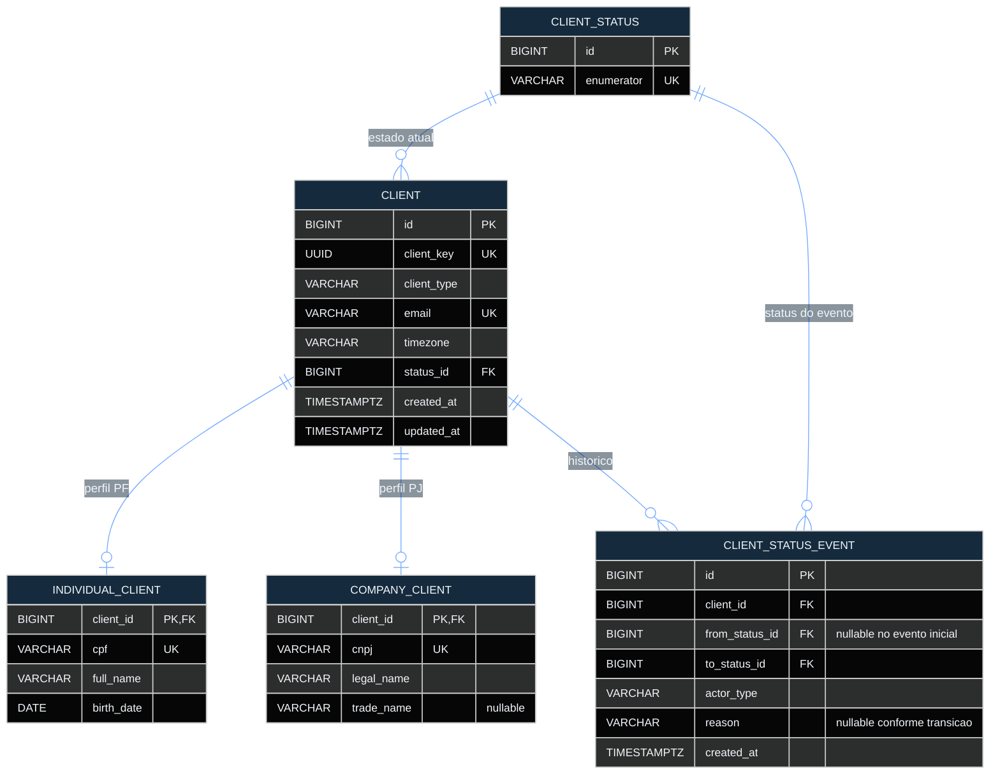
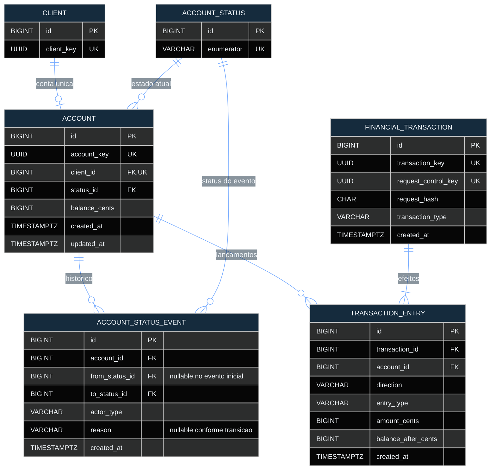

# RFC — BaaS simplificado com consistência financeira, controle de estados e extrato

| | |
|---|---|
| **Time** | João Vitor Miranda Sousa · Mohamad Ahmad Barakat |
| **Data** | 12/10/2026 |
| **Versão** | 2.1 |

## Contextualização

### Entendendo o problema

Uma plataforma parceira precisa oferecer operações bancárias básicas a clientes pessoa física (PF) e jurídica (PJ): cadastro, análise cadastral, abertura e gerenciamento de contas, depósitos, transferências e consulta de extrato. O maior risco é movimentar dinheiro de forma incorreta quando chegam requisições simultâneas, falhas parciais ou retentativas. Um débito sem crédito correspondente, uma tarifa cobrada duas vezes ou um histórico que não explique o saldo tornam o serviço inconsistente. Também é necessário impedir mudanças inválidas nos estados de clientes e contas e preservar o histórico dessas alterações. O escopo contempla uma plataforma por implantação, operação no Brasil e valores em reais (BRL). Não contempla multi-tenancy, PIX, TED, boletos, saques, estornos, integração comercial real de KYC nem contabilidade completa por partidas dobradas.

### Explicando a solução de forma macro

A solução separa cadastro e ciclo de vida do núcleo financeiro. Uma API organiza validações e regras de negócio, persiste estados, saldos e eventos no PostgreSQL e consulta um provedor de análise cadastral por HTTP, simulado com MockServer no ambiente de testes. Operações relacionadas são confirmadas em uma única transação de banco; locks de linha, com ordem fixa na transferência, protegem alterações concorrentes. Uma `Idempotency-Key` (UUID enviado no header) associada ao hash da intenção impede que uma retentativa gere novos efeitos financeiros. O extrato é construído a partir de lançamentos persistidos, com saldo após cada movimento e ordenação determinística.

- **Ledger completo de partidas dobradas** — descartado pelo custo de modelar contas internas de compensação e receita de tarifas; ganharia em um produto com contabilidade e conciliação formal.
- **Multi-tenancy no mesmo banco** — descartado pelo custo de isolar cada entidade e consulta por parceiro; ganharia com múltiplos parceiros na mesma implantação.
- **Paginação por cursor no extrato** — descartada pela complexidade adicional ao contrato inicial; ganharia com volumes muito grandes e navegação estável entre páginas.
- **Integração direta com um KYC comercial** — descartada por dependência de credenciais e disponibilidade externas; ganharia em operação real com fornecedor contratado.

## Implementação

### Rotas

| Método | Caminho | O que faz | Entrada (campos que importam) | Saídas (status e quando) |
|---|---|---|---|---|
| `POST` | `/client` | Cadastra PF/PJ em `PENDING`; não idempotente | `client_type`, email, CPF/CNPJ, dados PF/PJ, `timezone` | `201` criado; `400` dados/documento/timezone inválidos; `403` token inválido; `409` email/documento duplicado; `422` PF menor de 18 anos; `500` falha interna |
| `GET` | `/client/{client_key}` | Consulta cliente; idempotente por ser leitura | `client_key` | `200` encontrado; `400` chave inválida; `403` token inválido; `404` não encontrado; `500` falha interna |
| `POST` | `/client/{client_key}/analysis` | Analisa cadastro e decide `ACTIVE`/`REJECTED`; não idempotente | `client_key` | `200` análise concluída; `400` chave inválida; `403` token inválido; `404` não encontrado; `409` estado incompatível; `500` falha interna/provedor |
| `POST` | `/client/{client_key}/account` | Cria a única conta vitalícia do cliente; não idempotente | `client_key` | `201` criada; `400` entrada inválida; `403` token inválido; `404` cliente ausente; `409` cliente inelegível ou conta existente; `500` falha interna |
| `GET` | `/account/{account_key}` | Consulta conta e saldo; idempotente por ser leitura | `account_key` | `200` encontrada; `400` chave inválida; `403` token inválido; `404` não encontrada; `500` falha interna |
| `PATCH` | `/account/{account_key}` | Altera estado da conta e coordena o do cliente; não idempotente | `account_key`, `status`, `reason` | `200` alterada; `400` entrada inválida; `403` token inválido; `404` não encontrada; `409` transição/estado/saldo incompatível; `500` falha interna |
| `POST` | `/account/{account_key}/transaction` | Deposita ou transfere; idempotente por `Idempotency-Key` (header UUID) e hash da intenção | `Idempotency-Key` (header), `transaction_type`, `amount_cents`, `target_account_key` (transferência) | `201` criada ou repetição idêntica; `400` entrada inválida; `403` token inválido; `404` conta ausente; `409` conta inativa, transferência para si ou conflito de chave; `422` valor inválido/saldo insuficiente; `500` falha interna |
| `GET` | `/account/{account_key}/transactions` | Extrato paginado; idempotente por ser leitura | `account_key`, `page`, `limit`, `order_by`, `date_from`, `date_to` | `200` página (inclusive vazia); `400` chave/parâmetro inválido; `403` token inválido; `404` conta ausente; `422` período invertido; `500` falha interna |
| `PATCH` | `/client/{client_key}` | Reanálise ou alteração de estado sem conta; não idempotente | `client_key`, `status`, `reason` | `200` atualizado; `400` entrada inválida; `403` token inválido; `404` cliente ausente; `409` transição inválida ou mudança exige rota da conta; `500` falha interna |
| `GET` | `/health_check` | Verifica vida do processo HTTP; idempotente, sem token | Nenhuma | `204` aplicação respondendo; `500` falha interna inesperada |

### Banco de Dados (Somente diagrama)

### Fluxos

**Cadastro, análise e abertura de conta — caminho feliz**

1. O cadastro valida PF/PJ e grava cliente, perfil e evento inicial `PENDING` na mesma transação.
2. A análise consulta o provedor HTTP fora de locks longos; em seguida trava o cliente, revalida `PENDING` e confirma o estado `ACTIVE` ou `REJECTED` com seu evento.
3. Para cliente `ACTIVE`, a abertura trava o cliente, confirma que não existe conta e grava conta `ACTIVE`, saldo zero e evento inicial em um único `COMMIT`.

**Cadastro, análise e abertura de conta — falha: abertura simultânea**

1. Duas aberturas disputam o mesmo cliente; uma adquire primeiro o lock e cria a conta.
2. A segunda encontra a conta existente e recebe `409`. A restrição `UNIQUE(ACCOUNT.client_id)` reforça a garantia; não nasce segunda conta.

**Alteração de estados — caminho feliz**

1. Sem conta, a alteração elegível do cliente é revalidada sob lock e grava estado e evento juntos.
2. Com conta, a operação trava primeiro `CLIENT`, depois `ACCOUNT`, revalida as transições e confirma os dois estados e eventos no mesmo `COMMIT`.
3. Uma conta só é encerrada com saldo zero; `CLOSED` é terminal.

**Alteração de estados — falha: tentativa de fechar conta com saldo**

1. Sob os locks, o serviço verifica novamente `balance_cents` e encontra valor diferente de zero.
2. Retorna `409`, realiza `ROLLBACK` e não persiste mudança de estado nem evento.

**Depósito e transferência — caminho feliz**

1. A requisição é validada; a intenção é normalizada; o header obrigatório `Idempotency-Key` é persistido como `financial_transaction.request_control_key` (única globalmente) e associado ao `request_hash` SHA-256.
2. No depósito, a conta é travada e revalidada `ACTIVE`; crédito, saldo final e lançamento são gravados em uma transação.
3. Na transferência, origem e destino são travados por `ACCOUNT.id` crescente; estados e saldo são revalidados. A origem registra débito principal e débito de tarifa proporcional ao perfil do titular (PF: 0,50%, mínimo de 50 e máximo de 1.000 centavos; PJ: 1,00%, mínimo de 100 e máximo de 1.500 centavos; arredondamento `HALF_UP`). O destino recebe o crédito principal integral.
4. Saldos, operação financeira e lançamentos são confirmados em um único `COMMIT`; a resposta traz `transaction_key`.

**Depósito e transferência — falha: saldo insuficiente, concorrência ou retentativa**

1. Se o saldo da origem não cobre valor mais tarifa, retorna `422` após `ROLLBACK`; nenhuma escrita financeira ou chave de idempotência é confirmada.
2. Se a mesma chave já foi confirmada com a mesma intenção, retorna `201` com a transação original e **sem novo lançamento**.
3. Se a chave é reutilizada com intenção diferente, retorna `409`; locks ordenados e revalidação impedem gasto simultâneo do mesmo saldo.

**Consulta de extrato — caminho feliz**

1. O serviço valida conta e filtros, interpreta `date_from`/`date_to` no timezone cadastrado e converte os limites para UTC.
2. Lê lançamentos persistidos em ordem determinística; usa `limit + 1` para indicar se há próxima página.
3. Retorna `200` com lançamentos, saldos após os movimentos e dados de paginação, sem alterar saldo ou histórico.

**Consulta de extrato — falha: filtro inválido ou página sem registros**

1. Formato inválido retorna `400`; `date_from` posterior a `date_to` retorna `422`, sem qualquer escrita.
2. Uma conta válida sem movimentos, ou uma página além do fim, retorna `200` com lista vazia.

> ## Principal desafio
>
> - **Qual é:** garantir que transferências concorrentes, falhas parciais e retentativas não dupliquem operações nem tornem saldo e histórico divergentes.
> - **Por que é difícil:** requisições podem disputar o mesmo dinheiro, transferências inversas podem criar deadlocks e uma resposta pode se perder mesmo depois do `COMMIT`.
> - **Como o desenho resolve:** locks de linha em ordem global, revalidação depois do lock, gravação atômica com `ROLLBACK` integral e chave única de idempotência vinculada ao hash da intenção.
