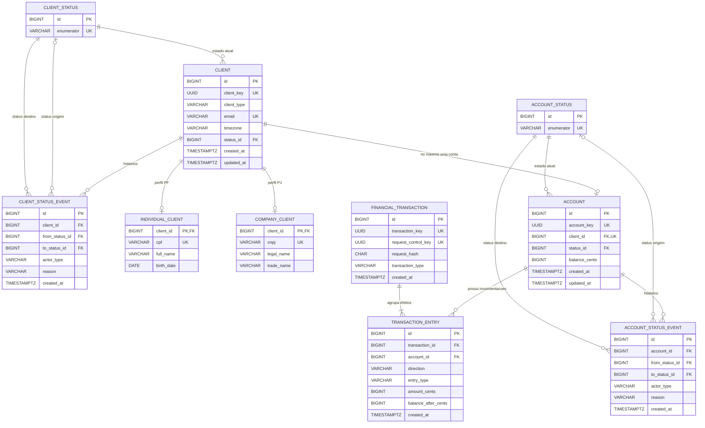

# RFC — BaaS simplificado com controle consistente de saldo, lifecycle e extrato

| | |
|---|---|
| **Time** | João Vitor · Mohamad |
| **Data** | 07/10/2026 |
| **Versão** | 1 |

## Contextualização

### Entendendo o problema

O projeto deve oferecer a uma plataforma parceira um serviço bancário simplificado para clientes PF e PJ, cobrindo cadastro, análise cadastral, abertura e gerenciamento de conta, depósitos, transferências e consulta de extrato. O ponto crítico é garantir que operações financeiras concorrentes não produzam saldo negativo, débito sem crédito correspondente ou histórico incoerente. Retentativas também não podem duplicar uma movimentação já confirmada, e o extrato deve permanecer compatível com a evolução real do saldo. Mudanças de estado de cliente e conta precisam ser rastreáveis e não podem gerar combinações incompatíveis. A entrega considera uma única plataforma parceira por implantação, operação no Brasil e moeda BRL. Ficam fora do escopo multi-tenancy, múltiplas moedas, PIX, TED, boleto, saque, reversão, integração com um fornecedor real específico de KYC e contabilidade completa por partidas dobradas.

### Explicando a solução de forma macro

A solução separa cadastro e lifecycle do núcleo financeiro, mantém o saldo operacional atual junto de um histórico imutável dos efeitos de cada operação e trata mudanças relacionadas como uma única unidade atômica. A análise cadastral chama um Analysis Provider por HTTP; no ambiente de desenvolvimento e teste, esse papel é exercido pelo MockServer com respostas determinísticas configuradas pelo pytest. Operações concorrentes sobre os mesmos recursos são serializadas por locks de linha e revalidadas antes da escrita; transferências seguem uma ordem global de locks para reduzir deadlocks. Retentativas financeiras usam uma chave de controle global combinada com um hash da intenção normalizada, permitindo devolver a operação original sem executá-la novamente. O extrato é derivado dos efeitos financeiros persistidos, preservando saldo após cada movimento, ordenação determinística e filtros de datas civis no timezone do cliente.

- **Full double-entry ledger** — descartado porque exigiria contas internas de clearing e receita de tarifa, além de alterar saldo, depósito, transferência, extrato e testes. Ganharia se o produto exigisse contabilidade bancária completa.
- **Multi-tenancy no mesmo banco** — descartado porque adicionaria isolamento por parceiro em todas as entidades e consultas. Ganharia se uma única implantação precisasse servir múltiplas plataformas simultaneamente.
- **Cursor/keyset pagination no extrato** — descartado porque aumentaria o contrato e a implementação sem necessidade para o volume do D0. Ganharia se histórico muito grande ou snapshot estável entre páginas virasse requisito.
- **Fornecedor real específico de KYC/bureau** — descartado porque o exercício precisa apenas demonstrar a integração. Um contrato mínimo de Analysis Provider, simulado por MockServer nos testes, preserva a fronteira HTTP sem depender de um serviço comercial.

## Implementação

### Rotas

| Método | Caminho | O que faz | Entrada (campos que importam) | Saídas (status e quando) |
|---|---|---|---|---|
| `POST` | `/client` | Cadastra PF/PJ em `PENDING`; não idempotente | `client_type`, email, CPF ou CNPJ, dados PF/PJ, `timezone` | `201` criado; `400` schema/documento/timezone inválido; `403` token inválido; `409` email/CPF/CNPJ duplicado; `422` PF menor de 18; `500` interno |
| `GET` | `/client/{client_key}` | Consulta snapshot do cliente; GET idempotente | `client_key` | `200` encontrado; `400` UUID inválido; `403` token inválido; `404` cliente inexistente; `500` interno |
| `POST` | `/client/{client_key}/analysis` | Solicita análise externa e aplica `PENDING -> ACTIVE/REJECTED`; não idempotente | `client_key`; sem body obrigatório | `200` analisado; `400` UUID inválido; `403` token inválido; `404` cliente inexistente; `409` estado não permite análise; `500` falha interna ou do provider |
| `POST` | `/client/{client_key}/account` | Abre a única conta vitalícia do cliente; não idempotente | `client_key` | `201` conta criada; `400` request inválida; `403` token inválido; `404` cliente inexistente; `409` cliente não `ACTIVE` ou conta já existe; `500` interno |
| `GET` | `/account/{account_key}` | Consulta snapshot da conta; GET idempotente | `account_key` | `200` encontrada; `400` UUID inválido; `403` token inválido; `404` conta inexistente; `500` interno |
| `PATCH` | `/account/{account_key}` | Altera lifecycle da conta e coordena o cliente; não idempotente | `account_key`, `status`, `reason` | `200` alterada; `400` request inválida; `403` token inválido; `404` conta inexistente; `409` transição/estado/saldo incompatível; `500` interno |
| `POST` | `/account/{account_key}/transaction` | Executa `DEPOSIT` ou `TRANSFER`; idempotente por `request_control_key` global + `request_hash` | `request_control_key`, `transaction_type`, `amount_cents`, `target_account_key` em transferência | `201` criada ou replay; `400` request inválida; `403` token inválido; `404` conta inexistente; `409` conta não ativa/self-transfer/conflito de idempotência; `422` valor menor que 1 ou saldo insuficiente; `500` interno |
| `GET` | `/account/{account_key}/transactions` | Consulta extrato paginado; GET idempotente | `account_key`, `page`, `limit`, `order_by`, `date_from`, `date_to` | `200` página do extrato; `400` key/query/formato inválido; `403` token inválido; `404` conta inexistente; `422` `date_from > date_to`; `500` interno |
| `PATCH` | `/client/{client_key}` | Reanálise ou lifecycle direto sem conta; não idempotente | `client_key`, `status`, `reason` | `200` alterado; `400` request inválida; `403` token inválido; `404` cliente inexistente; `409` transição incompatível ou lifecycle deve passar pela conta; `500` interno |
| `GET` | `/health_check` | Liveness da API; GET idempotente e sem autenticação | — | `204` processo HTTP vivo; `500` apenas falha interna inesperada |

### Banco de Dados (Somente diagrama)

### Fluxos

**Onboarding — caminho feliz**

1. O parceiro cadastra um cliente; a entrada é validada e normalizada, e cliente, especialização PF/PJ e evento inicial `NULL -> PENDING` são confirmados no mesmo `COMMIT`.
2. A análise lê o cliente `PENDING`, chama o Analysis Provider sem manter lock aberto, depois trava e revalida o cliente antes de confirmar `PENDING -> ACTIVE/REJECTED` com o respectivo evento.
3. A abertura de conta trava o cliente, revalida `ACTIVE` e ausência de conta anterior, cria a conta `ACTIVE` com saldo zero e registra o evento inicial no mesmo `COMMIT`.

**Onboarding — falha: abertura concorrente de conta**

1. Duas requisições disputam o mesmo cliente; somente uma obtém o lock primeiro.
2. A primeira cria a conta e confirma. A segunda relê o estado, encontra a conta existente e recebe `409`; a restrição de unicidade de `client_id` permanece como barreira final.

**Lifecycle — caminho feliz**

1. Sem conta existente, reanálise e `ACTIVE <-> INACTIVE` travam somente o cliente, revalidam o estado e confirmam estado + evento juntos.
2. Com conta existente, a mudança passa pela conta: o cliente é travado antes da conta, os dois estados são revalidados e as mudanças coordenadas são confirmadas em um único `COMMIT`.
3. `CLOSED` é terminal e só pode ser alcançado com saldo zero.

**Lifecycle — falha: fechamento com saldo**

1. A operação trava cliente e conta na ordem global e relê `balance_cents`.
2. Se o saldo não for zero, nenhuma mudança nem evento é confirmado; ocorre `ROLLBACK` e o caller recebe `409`.

**Movimentação financeira — caminho feliz**

1. A API valida e normaliza a intenção, calcula o hash e resolve a chave idempotente antes de qualquer novo efeito financeiro.
2. Em `DEPOSIT`, a conta é travada e revalidada `ACTIVE`; saldo, transação e `CREDIT/PRINCIPAL` são confirmados juntos.
3. Em `TRANSFER`, as duas contas são resolvidas e travadas por `ACCOUNT.id` crescente, depois têm estado e saldo revalidados.
4. A origem recebe `DEBIT/PRINCIPAL` e `DEBIT/FEE` de 200 centavos; o destino recebe `CREDIT/PRINCIPAL`; entries e saldos são confirmados em um único `COMMIT`.

**Movimentação financeira — falha: saldo insuficiente ou retry**

1. Se, após os locks, a origem não cobre principal + tarifa, a operação inteira sofre `ROLLBACK`, sem consumir a chave de controle, e retorna `422`.
2. Se uma operação já confirmada for repetida com a mesma chave e o mesmo hash, a API devolve a transação original com `201` e não movimenta saldo novamente; a mesma chave com hash diferente retorna `409`.

**Extrato — caminho feliz**

1. A API valida paginação e filtros, localiza a conta e obtém o timezone do cliente proprietário.
2. Datas civis são convertidas desse timezone para limites UTC; o histórico é ordenado deterministicamente por timestamp financeiro, transação e entry.
3. A consulta busca `limit + 1`, devolve até `limit` itens e calcula `next_page` sem `COUNT(*)`; a contraparte é derivada na leitura.

**Extrato — falha/alternativo: ausência de registros e intervalo inválido**

1. Conta existente sem movimentações ou página além do fim retorna `200` com `data = []`.
2. Formato de query inválido retorna `400`; `date_from > date_to`, embora ambas as datas sejam válidas, retorna `422`.

> ## Principal desafio
>
> - **Qual é:** garantir consistência de saldo e ausência de duplicidade em transferências concorrentes e em retentativas.
> - **Por que é difícil:** duas requisições podem ler e tentar gastar o mesmo saldo, transferências em sentidos opostos podem adquirir locks em ordem inversa, e uma resposta HTTP pode se perder depois de o dinheiro já ter sido confirmado.
> - **Como o desenho resolve:** locks de linha com ordem global por `ACCOUNT.id`, revalidação de estado e saldo após os locks, todas as escritas financeiras em um único `COMMIT` com `ROLLBACK` integral, e idempotência por `request_control_key` globalmente única mais hash SHA-256 da intenção canonicalizada.
